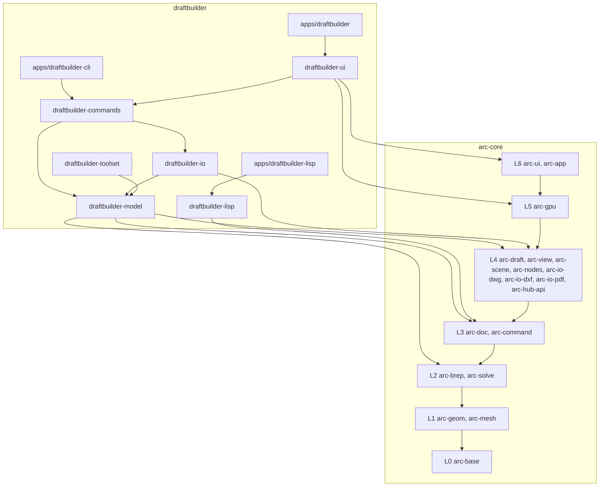

# DraftBuilder

2D drafting and 3D CAD on the DWG/DXF drawing data model, part of the Arc suite.

> **Status: design phase.** No builds are available yet. This repository contains the product definition, architecture and roadmap that implementation follows.

## What DraftBuilder is

DraftBuilder is a general-purpose 2D drafting and 3D CAD application whose native model is the
DWG/DXF drawing database. It opens and saves `.dwg` and `.dxf` files directly and preserves every
object it does not understand; it provides a keyboard-first command line with the conventional
command vocabulary and aliases, precise drafting, annotation, blocks with attributes and dynamic
behavior, external references, parametric constraints, layouts, plotting and sheet sets, 3D solids,
surfaces, meshes and point clouds; and it runs existing scripts and Lisp routines. Optional toolsets
add architecture, mechanical, building services, electrical controls, plant, mapping and raster work.
It is written in Rust, runs on Windows, macOS and Linux with identical features, runs in browsers
and on tablets and phones as further targets of the same code, and needs no account or network.

## Who it is for

Drafters and designers who produce DWG and DXF deliverables in architecture, engineering,
construction, manufacturing, survey and utilities; CAD managers who maintain templates, standards
and customization for teams; and developers who automate drawing production.

## Capability areas

| Area | Scope | File |
|---|---|---|
| Drawing database | Spaces, entities, symbol tables, handles, extended data, preservation, files, undo | [01](docs/product/capabilities/01-drawing-database.md) |
| Command interface | Command line, prompts, aliases, cursor input, workspace, navigation, settings | [02](docs/product/capabilities/02-command-interface.md) |
| Precision | Object snaps, tracking, polar, ortho, coordinates, user coordinate systems, measurement | [03](docs/product/capabilities/03-precision.md) |
| Selection and grips | Selection methods, query selection, filters, grips | [04](docs/product/capabilities/04-selection-grips.md) |
| 2D drawing | Lines, polylines, circles, arcs, splines, regions, boundaries, multilines | [05](docs/product/capabilities/05-draw-2d.md) |
| 2D modification | Transform, trim, extend, fillet, offset, arrays, explode, cleanup | [06](docs/product/capabilities/06-modify-2d.md) |
| Layers and properties | Layers, states, filters, viewport overrides, linetypes, lineweights | [07](docs/product/capabilities/07-layers-properties.md) |
| Text, tables and fields | Text, styles and fonts, fields, tables, data links, extraction | [08](docs/product/capabilities/08-text-tables-fields.md) |
| Dimensions and leaders | Dimensions, styles, tolerances, leaders, center marks | [09](docs/product/capabilities/09-dimensions-leaders.md) |
| Hatches and fills | Hatches, patterns, gradients, solid fills | [10](docs/product/capabilities/10-hatch-fill.md) |
| Blocks and attributes | Blocks, attributes, in-place editing, dynamic blocks, libraries | [11](docs/product/capabilities/11-blocks-attributes.md) |
| References and underlays | External references, images, PDF and DGN underlays, PDF import, 3D references, embedded objects | [12](docs/product/capabilities/12-references-underlays.md) |
| Parametric constraints | Geometric and dimensional constraints, parameter table | [13](docs/product/capabilities/13-parametric-constraints.md) |
| Layouts and plotting | Layouts, viewports, annotation scaling, plotting, publishing, sheet sets | [14](docs/product/capabilities/14-layouts-plotting.md) |
| 3D modeling and visualization | Solids, surfaces, meshes, sections, drawing views, rendering | [15](docs/product/capabilities/15-3d-modeling-visualization.md) |
| Point clouds and geolocation | Point clouds, coordinate reference systems, base maps | [16](docs/product/capabilities/16-point-clouds-geolocation.md) |
| Compare, history and collaboration | Drawing compare, history, markup, Arc Hub, multi-user editing | [17](docs/product/capabilities/17-compare-history-collaboration.md) |
| Customization and automation | UI customization, scripts, macros, Lisp, protocol, CLI, plug-ins | [18](docs/product/capabilities/18-customization-automation.md) |
| Interoperability and standards | DWG, DXF and other formats, fonts, standards checking, packages | [19](docs/product/capabilities/19-interoperability-standards.md) |
| Toolsets | Framework and seven discipline toolsets | [20](docs/product/capabilities/20-toolset-framework.md) to [27](docs/product/capabilities/27-toolset-raster.md) |
| Web and mobile | Browser, tablet and phone builds, touch and pen input, offline drawings, synchronization | [28](docs/product/capabilities/28-web-and-mobile.md) |

## How it fits in the suite

DraftBuilder depends only on [`arc-core`](https://github.com/ACKaraca/arc-core) and permissively
licensed third-party crates. It cooperates with other Arc products at run time through the three
suite contracts:

- **Arc document package:** the `.draftb` sidecar holding history and settings, and attachment of
  other Arc documents as references.
- **Arc Scene contract:** export of 3D content, lights, cameras and materials to RenderBuilder for
  rendering.
- **Hub API:** opening and saving through Arc Hub, locks, versions, reviews, issues and, later,
  multi-user change sets.

Its sheet and plot pipeline is the shared `arc-draft` pipeline used by every Arc product.

## Architecture at a glance

Details are in [docs/architecture/overview.md](docs/architecture/overview.md).

## Roadmap summary

| Milestone | Suite phase | Theme |
|---|---|---|
| M0 | 0 | Foundation readiness |
| M1 | 1 | Drawing core: database, command line, precision, selection, draw, modify, layers, DXF read and write, DWG read |
| M2 | 1 | Annotation, blocks, references, layouts and PDF plotting |
| M3 | 2 | DWG write, Lisp and scripts, dynamic blocks, constraints, sheet sets, standards, compare, Arc Hub |
| M4 | 3 | 3D solids, surfaces and meshes, drawing views, point clouds, geolocation, open 3D exchange |
| M5 | 4 | Rendering through RenderBuilder, node graphs, toolsets |
| M6 | 5 | Multi-user editing of one drawing, optional assistant |

See [docs/roadmap.md](docs/roadmap.md).

## Documentation

The documentation map is [docs/README.md](docs/README.md). Automated agents start with
[AGENTS.md](AGENTS.md).

## Contributing

Read [CONTRIBUTING.md](CONTRIBUTING.md). Work starts from an issue, every commit carries a Developer
Certificate of Origin sign-off, and behavior changes update the capability rows they affect.

## License

Apache License 2.0; see [LICENSE](LICENSE) and [NOTICE](NOTICE).

## Trademark notice

Arc, ArchBuilder, DraftBuilder, CivilBuilder, SolidBuilder, MeshBuilder, RenderBuilder, Arc Review and Arc Hub are names of this project and are not covered by the Apache License; see the [trademark policy](https://github.com/ACKaraca/arc-suite/blob/main/TRADEMARKS.md). All other product and company names are trademarks of their respective owners and are used only to describe scope and interoperability.
