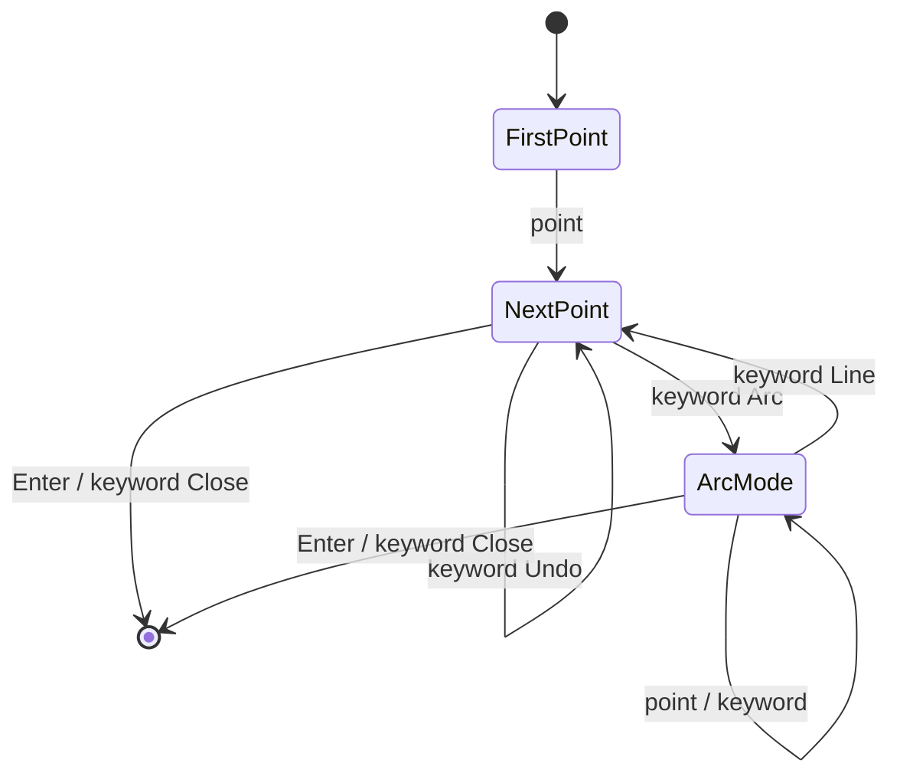

# Command line architecture

This document describes how DraftBuilder commands take input: interactive prompt machines, options
and defaults, transparent commands, repetition, aliases, autocomplete, scripts, the Lisp-dialect
interpreter, settings names, and how every interactive command also has a non-interactive form. It
builds on the command model of `arc-command`; capabilities are specified in
[02-command-interface.md](../product/capabilities/02-command-interface.md) and
[18-customization-automation.md](../product/capabilities/18-customization-automation.md).

## Command definition

Each DraftBuilder command registers with `arc-command`:

| Part | Content |
|---|---|
| Stable id | `draftbuilder.<area>.<name>`, for example `draftbuilder.modify.trim`; never changes |
| Command names | The conventional English name (`TRIM`) and localized names; the English name is always accepted with the underscore prefix |
| Aliases | Default short names (`TR`), overridable by alias files |
| Parameter schema | Typed parameters (points, distances, angles, selections, keywords, strings, enumerations) with units, ranges and defaults |
| Enabled predicate | When the command may run (for example only in paper space) |
| `run` | Non-interactive execution with complete parameters; never prompts and never opens a dialog |
| Prompt machine | Optional interactive state machine that collects parameters and previews the result |
| Flags | Transparent-eligible, repeatable, selection-first aware, modifies document or view only |

## Prompt machines

A prompt machine is a state machine whose states are prompts. Each prompt declares:

- the expected input kind (point, distance, angle, integer, real, string, keyword, selection, object
  pick, or a combination such as "point or keyword");
- the option keywords available at that prompt, each with a canonical keyword, its keyboard
  abbreviation and a localized label;
- the default value, which is shown with the prompt and taken on Enter or Space;
- the rubber-band and preview behavior while input is pending.

The diagram shows the polyline command: nested prompts change the set of options until the user
returns to the outer state. Prompt machines are pure functions of their state and the next token,
which makes every interactive session reproducible from its token list.

### Tokens and sources

All input is reduced to tokens before it reaches a prompt machine: typed text, picked points
(already resolved through object snaps, tracking and constraints), picked objects, selection sets,
Enter, Escape and option clicks. The same token stream comes from:

| Source | How tokens are produced |
|---|---|
| Keyboard and pointer | Command line, cursor input fields, option menus, pointer picks |
| Menus and panels | A menu item is a macro string expanded into tokens |
| Scripts | Each whitespace-separated item of an SCR file is a token; a blank line is Enter |
| Macro recordings | Recorded tokens with marked pauses for user input |
| Lisp routines | `command` calls pass tokens; input functions request a prompt of a given kind |
| Automation protocol | `command.prompt` sends tokens; `command.run` bypasses the prompt machine |

### Defaults and remembered values

Defaults come from the parameter schema, then from the value used last in this session or stored in
the drawing (for example the last offset distance or fillet radius), as the parameter declares. A
remembered value is stored as a DraftBuilder setting with a defined scope (drawing, profile or
session), so scripts can set it explicitly.

### Preview

While a prompt waits for a point or a distance, the prompt machine computes a preview of the result
from the partial parameters on a worker thread; previews never enter the document. Commands with
heavy previews (trim across many objects, fillet of complex polylines) cancel stale preview jobs as
the pointer moves.

## Option keywords and localization

Canonical option keywords are English and stable; localized labels and abbreviations are shown in
the interface. A keyword prefixed by an underscore is always interpreted as the canonical keyword, so
scripts and routines written for one interface language run in all others. Commands accept the
conventional option keywords that existing scripts depend on.

## Transparent commands

A command flagged transparent-eligible (view changes, setting changes, inquiry, calculator, layer
changes that do not edit the selection) can start while another command waits at a prompt, when
typed with the apostrophe prefix or invoked from a menu. The outer prompt machine is suspended, the
transparent command runs in its own transaction or with no transaction at all (view-only), and the
outer prompt resumes with its state intact. Transparent commands cannot nest beyond one level and are
refused at prompts that declare themselves non-interruptible, for example while a selection window
is being dragged.

## Repetition

- Enter or Space at an empty prompt repeats the last command; the last few commands are offered from
  the right-click menu and the history.
- `MULTIPLE` repeats the next command until Escape.
- Commands flagged repeatable restart automatically after completion when their definition asks for
  it (for example point placement).

## Aliases and command resolution

Typed names resolve in this order: localized command name, conventional English name, alias, command
defined by a loaded Lisp routine, plug-in command. The `.` prefix forces a built-in command even if a
routine redefined it; the `_` prefix forces the English name; the `-` prefix selects the dialog-free
prompt form. Alias files in the conventional PGP format are imported and exported
([DB-CMD-010](../product/capabilities/02-command-interface.md)); the active alias set is a documented
text file. Collisions between an alias and a command name are reported when the file loads.

As implemented: `draftbuilder-commands` keeps the product's typed names and short aliases in one table
(`vocabulary`) and registers one name resolver (`names::resolver`, installed by `registry()`). The
resolver reads the prefixes `_` (the English name: a vocabulary name or an identifier), `-` (the prompt
form; flag `no_dialogs`) and `.` (the built-in command; flag `builtin_only`, so user aliases are never
consulted). Because the registry consults the resolver on every surface, the command line, the
automation protocol, macros, scripts and the CLI `run` subcommand read the same forms; the CLI has no
rewriting of its own. Commands read the flags with `Context::name_flags`; none opens a dialog yet, so
none reads `no_dialogs`.

## Autocomplete and search

As the user types, the command line proposes matches from command names, aliases, routine-defined
commands, settings (by DraftBuilder name and by compatibility name) and, where the prompt expects a
named object, layer, block and style names. Matching is prefix first, then substring, then by
synonyms and descriptions; recently used entries rank higher. Command search in the interface uses
the same index, including localized labels and descriptions.

## Non-interactive forms

Every command has three entry forms that share one implementation:

| Form | Use | Behavior |
|---|---|---|
| Interactive | Keyboard and pointer | Prompt machine with preview; dialogs and panels may be offered for convenience |
| Prompt form (`-COMMAND`) | Scripts, macros, Lisp, typed use | The same prompt machine with every setting reachable by prompts; never opens a dialog |
| Direct run | Automation protocol, CLI, Hub jobs, plug-ins, node graphs | `run` with a complete parameter object validated against the schema; returns a structured result |

A command that offers a dialog in interactive use also exposes every dialog field in its parameter
schema and its prompt form. Programmatic execution never opens a dialog
([DB-CMD-013](../product/capabilities/02-command-interface.md)).

## Settings and compatibility names

DraftBuilder settings have dotted names with a declared type, unit, range, default and scope:

| Scope | Stored in | Example |
|---|---|---|
| Drawing | Header settings of the drawing (or the sidecar package when the format has no field) | `draft.linetype.global_scale` |
| Profile | User profile file | `snap.object.running` |
| Session | Memory only | `command.echo` |

Existing scripts, routines and drawings use widely known setting names. The compatibility table maps
each such name to a DraftBuilder setting, including value conversion where encodings differ (for
example bit flags to a set of enumerated values). Reading and writing a setting through a
compatibility name behaves as reading and writing the mapped setting
([DB-CMD-043](../product/capabilities/02-command-interface.md)). Names without a mapping are reported
once per session and return a typed "unsupported setting" result rather than a silent default.

## Scripts

A script is a text file of command-line tokens run through the same token path as typing. Scripts are
designed to run interactively (with display updates) or headless through the CLI over a set of drawings,
with a per-drawing report, and `RSCRIPT`, delays and resume points behave conventionally
([DB-AUTO-011](../product/capabilities/18-customization-automation.md),
[DB-AUTO-012](../product/capabilities/18-customization-automation.md)). As implemented in M1, a script is
typed lines run through `CommandLine` on one drawing, one package per `draftbuilder-cli script` run; the
interactive run, the set of drawings, `RSCRIPT`, delays and resume points are not built yet. The rules and
the report are in [overview.md](overview.md#scripts-and-workflows). A line that sets a setting beside a waiting
prompt is refused unless the setting cannot change the meaning of an answer already given (the list is
`settings::TRANSPARENT_SETTINGS`); a script is limited in size, line length, line count and tokens per line. A failing command stops the script for
that drawing, rolls back the failing command and records the failure.

## Lisp-dialect interpreter

The interpreter runs existing user routines written in the Lisp dialect common to DWG applications
([DB-AUTO-015](../product/capabilities/18-customization-automation.md) to
[DB-AUTO-026](../product/capabilities/18-customization-automation.md)).

| Aspect | Design |
|---|---|
| Process | Separate host process (`apps/draftbuilder-lisp`), one namespace per open drawing plus an optional shared namespace ([ADR-0005](../adr/0005-lisp-interpreter-out-of-process.md)) |
| Connection | Automation protocol over a local channel; the host never links the model |
| Defined commands | A function named with the command prefix registers a command in the registry; it appears in autocomplete and can carry an alias |
| `command` calls | Send tokens to the target command's prompt machine within the routine's transaction group |
| Input functions | Request a prompt of the given kind from the active prompt machine, with keyword lists and input restrictions; the user answers in the normal interface |
| Entity access | Group-code association lists map to and from database objects using the DXF group-code vocabulary, so routines read and modify entities exactly as the file format describes them |
| Selection sets | Filters in group-code form evaluated by the model's query engine; selection-set handles are protocol objects |
| Object-model functions | The object-oriented function families are mapped onto the DraftBuilder object model; unsupported members raise a named error ([OQ-09](../product/open-questions.md)) |
| Event callbacks | A defined subset of object, command and drawing events, delivered asynchronously and coalesced |
| Dialogs | Dialog definition files (DCL) are parsed into a declarative description and rendered by the native UI |
| Batching | Consecutive entity reads and writes are batched into single protocol calls to meet the performance target in [overview.md](overview.md) |
| Safety | Loading follows trusted locations and secure-load levels ([DB-AUTO-010](../product/capabilities/18-customization-automation.md)); file and process access is limited to granted paths; each top-level command is one undo step; a routine can be stopped at any time and its partial transaction rolls back |
| Tooling | A language server and debug adapter for editors ([DB-AUTO-025](../product/capabilities/18-customization-automation.md)) |
