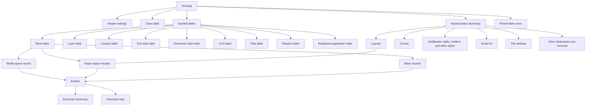
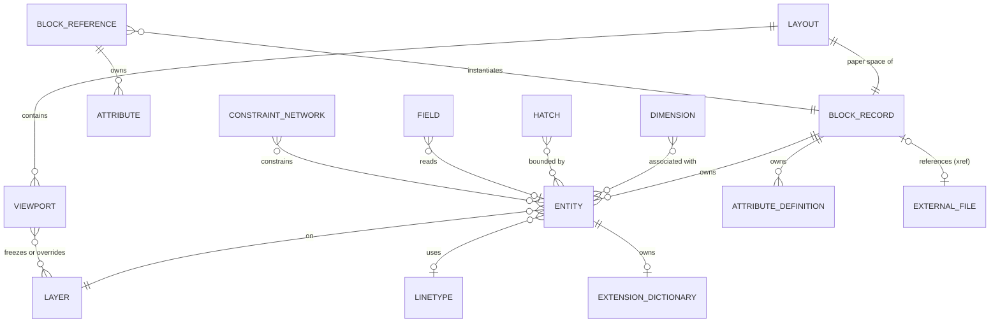

# DraftBuilder domain model

This document defines the object types of the drawing database, their relationships, invariants,
identity rules and the rules that decide what recomputes when something changes. The model follows
the DWG/DXF data model object for object ([ADR-0001](../adr/0001-drawing-database-is-the-model.md));
the shared drafting types come from `arc-draft` and are extended here with drawing-database semantics.

## Structure

## Object types

### Database-level objects

| Type | Key properties | Notes |
|---|---|---|
| Drawing | Format family and version, fingerprint GUID, version GUID, handle seed, code page, units, header settings | One per file; root of the owner tree |
| Header setting | Name, typed value | Stored with its format name; exposed through DraftBuilder settings ([command-line.md](command-line.md)) |
| Class record | Class name, application name, proxy flags, instance count | Describes every non-built-in object class in the file |
| Symbol table | Kind, records | Fixed set of tables; records are named and owned by their table |
| Dictionary | Entries name to object, duplicate-record policy, hard or soft ownership | Named object dictionary is the root dictionary |
| Extension dictionary | Owner object, entries | Any object may own one; holds application data |
| Xrecord | Typed value list (group code, value) | Arbitrary data in dictionaries |
| Extended data | Registered application name, typed value list | Attached to any object; size limit enforced as the format defines |
| Preserved object | Class record, raw data, owner handle, references, proxy graphics | Content DraftBuilder does not model ([ADR-0003](../adr/0003-lossless-preservation.md)) |

### Symbol table records

| Record | Key properties |
|---|---|
| Block record | Name, base point, units, explode and scale flags, annotative flag, layout link, entity list, draw-order table, dynamic block data |
| Layer | Name, on, frozen, locked, plot flag, color, linetype, lineweight, transparency, plot style name, description, new-viewport frozen |
| Linetype | Name, description, pattern elements (dash, shape, text), pattern length |
| Text style | Name, font file, big font file, outline font, fixed height, width factor, oblique angle, generation flags, annotative flag |
| Dimension style | Name, the full set of dimension variables, sub-style links per dimension type |
| UCS | Name, origin, X and Y axes |
| View | Name, center, size, direction, camera, layer state, visual style, live section, background |
| Viewport (tiled) | Name, view parameters, snap, grid and UCS settings |
| Registered application | Name |

### Entities

All entities share: handle, owner (a block record), layer, color, linetype, linetype scale,
lineweight, transparency, plot style, material, visibility, extrusion normal, thickness where the
format defines it, extension dictionary, extended data, hyperlink, and annotation scale
representations for annotative types.

| Group | Types |
|---|---|
| Curves | Line, construction line, ray, circle, arc, ellipse, lightweight polyline, 2D and 3D polyline with vertices, spline, helix, point, multiline |
| Areas and masks | Hatch (pattern, solid, gradient), region, 2D solid, trace, wipeout, revision cloud as polyline |
| Annotation | Text, paragraph text, attribute definition, attribute, dimension (rotated, aligned, angular, radial, diameter, jogged, arc length, ordinate), leader, multileader, tolerance frame, table, center mark and centerline, arc-aligned text |
| References | Block reference, grid block reference, external reference (block reference to an external block record), raster image, PDF and other underlays, embedded object frame, point cloud reference, Arc document reference |
| Layout | Paper space viewport |
| 3D | Solid, surface (procedural and NURBS), body, region, mesh, polyface and polygon meshes, 3D face, section plane, light, camera, sun, geographic location |
| Toolset | Typed domain objects defined by the toolset framework ([20-toolset-framework.md](../product/capabilities/20-toolset-framework.md)) |

### Non-graphical named objects

| Type | Key properties |
|---|---|
| Layout | Name, tab order, paper space block record, page setup, limits, active viewport |
| Page setup (plot settings) | Device, paper, plot area, scale, offset, plot style table, shading, options |
| Group | Name, description, selectable flag, ordered member handles |
| Scale | Name, paper units, drawing units |
| Styles in dictionaries | Multileader, table, multiline, visual, section view, detail view, material |
| Field | Expression code, evaluation options, cached value, owning text or cell |
| Data link | Source path, range, update direction and options, cached cell values |
| Constraint network | Constrained geometry references, constraints, parameters with expressions, solver state |
| Associative network | Action (array, associative dimension, surface), dependencies on geometry |
| Layer state, layer filter | Stored in the layer table's extension dictionary as the format defines |
| Sheet set | External sheet set file ([14-layouts-plotting.md](../product/capabilities/14-layouts-plotting.md)); referenced, not owned |

## Relationships

| Relationship | Rule |
|---|---|
| Ownership | Every object except the drawing has exactly one owner. Entities are owned by a block record; records by their table; dictionary entries by their dictionary. Deleting an owner deletes what it hard-owns. |
| Hard and soft pointers | References between objects are typed as hard or soft ownership or pointer, as the format defines. Purge counts hard pointers; soft pointers never keep an object alive. |
| Block instancing | A block reference names one block record; nesting forms a directed acyclic graph. |
| External references | An external block record holds a path and a resolved drawing loaded read-only into a separate database; its symbols appear with the dependent prefix and are not saved into the host. |
| Layout and space | Each layout owns exactly one paper space block record; model space has no layout record of its own. |
| Associations | Associative dimensions, hatches, arrays, leaders, center marks and constraints refer to geometry by stable ID plus sub-element (vertex, edge, segment) and record the geometric parameter they depend on. |
| Fields | A field refers to objects by stable ID; a dangling reference evaluates to a marked placeholder and is reported. |

## Identity rules

- **Handle.** Every object has a handle unique within the drawing, assigned from the handle seed and
  never reused, including after undo and purge. Handles survive save and reload unchanged.
- **Stable ID.** The 128-bit stable ID is derived from the drawing fingerprint GUID and the handle
  ([ADR-0002](../adr/0002-stable-ids-from-fingerprint-and-handle.md)). It is identical across sessions
  and copies of the file and is what the journal, history, Hub issues, links and change sets use.
  In memory, objects are addressed by dense handles provided by `arc-doc`.
- **Copies.** Copying objects into another drawing (paste, insert, block write) assigns new handles
  and therefore new stable IDs, and remaps every internal reference, including references inside
  extended data and xrecords that carry handle type codes.
- **Save as a new file.** A file saved under a new name keeps its fingerprint unless the user chooses
  to create an independent copy, which generates a new fingerprint and thereby new stable IDs.
- **Names.** Symbol names are unique within their table, compared case-insensitively; the reserved
  records (layer 0, continuous linetype, standard styles, model and paper space) always exist.

## Invariants

1. The owner tree is a tree; every object is reachable from the drawing root, and every reference
   resolves or is held as a reported raw value.
2. Handles are unique and below the handle seed.
3. Block nesting is acyclic; inserting a block into its own definition is refused.
4. Entities in an external block record are never written into the host drawing.
5. Every change is made by a command inside a transaction; there is no other write path.
6. Preserved objects are written back unchanged unless the preservation rules of
   [ADR-0003](../adr/0003-lossless-preservation.md) mark them invalidated, and every invalidation is
   reported.
7. Annotation scale representations of an object always include the scale it was created at.
8. Derived data (display lists, hatch lines, dimension blocks, dynamic block representations,
   proxy graphics written for others) can be discarded and rebuilt at any time without changing
   the drawing's meaning.

## Regeneration and dependency rules

Derived data is computed by nodes in the `arc-doc` dependency graph. A node recomputes when one of
its inputs changes; results carry the revision they were computed from.

| Derived data | Inputs | Recomputes when |
|---|---|---|
| Entity display list | Entity geometry, layer and linetype properties, linetype scales, text style, display quality settings, annotation scale | Any input changes; a viewport's annotation scale changes for annotative entities |
| Block reference display | Block record entities, reference transform, attribute values, ByBlock properties | The block record or any nested block record changes |
| Associative dimension | Associated geometry points, dimension style, overrides, annotation scale | Associated geometry moves or changes; style changes |
| Dimension block written to file | Dimension geometry and style | Computed on save from the dimension; never edited directly |
| Associative hatch | Boundary objects, pattern, scale, angle, origin | A boundary object changes; if the boundary no longer closes, associativity is removed and reported |
| Associative array | Source objects, path, parameters | Source, path or parameters change |
| Field value | Referenced object properties, drawing properties, sheet set data, date | On the evaluation triggers set for the drawing (open, save, plot, regenerate) or explicit update |
| Data-linked table | External range, link options | Explicit update or on open, per the link setting |
| Constraint network | Constrained geometry, constraints, parameter expressions | A constrained object or parameter changes; the solver runs on the network only |
| Dynamic block representation | Block definition, parameter values of the reference | A parameter value or the definition changes; the anonymous representation is regenerated |
| External reference | Referenced file contents | The file changes on disk and the user reloads, or on open |
| Layout and viewport display | Model content, viewport view, layer freezes and overrides | Model content in view changes; viewport parameters change |
| Drawing views from 3D | Source solids, view definition | Source solids change; update is explicit or automatic per view setting |
| Toolset object graphics | Object parameters, style, display configuration | Any input changes; the graphics written for other applications are refreshed on save |

Rules that apply to every node:

- Regeneration never modifies primary data. A command that needs a derived result (for example
  explode of a dimension) waits for the current revision of that node.
- Cycles in associations are refused when created.
- A node whose computation fails keeps its previous result, marks the object, and reports the
  failure; it never aborts the transaction that triggered it.

## Toolsets at framework level

Toolset objects are typed objects in the same database. Each has a class registered by its toolset
module, parameters validated by a schema, a style reference, property sets and display
representations. In a DWG file they are written as custom objects with proxy graphics plus, in their
extension dictionaries, plain-entity fallbacks; applications without the toolset see and plot the
fallback geometry, and DraftBuilder restores the typed object on open
([ADR-0006](../adr/0006-toolset-objects-degrade-to-entities.md)). Property sets can also be attached
to plain entities. Project data shared by several drawings lives in a sidecar package, never inside
one drawing.
