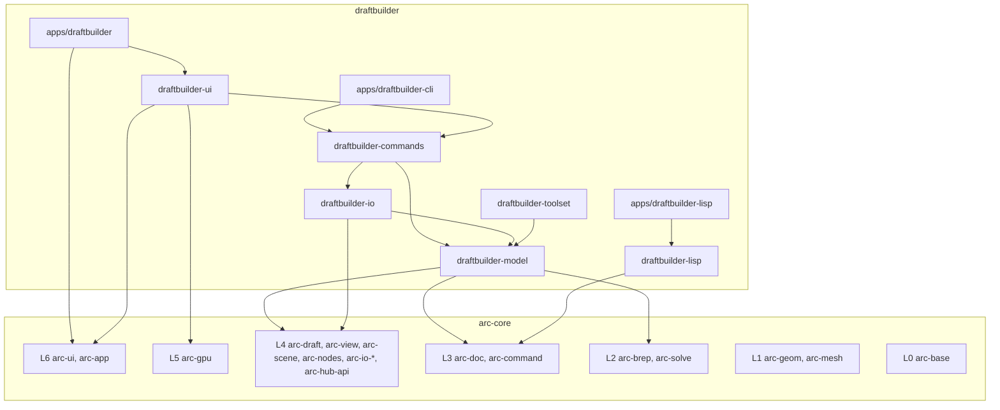
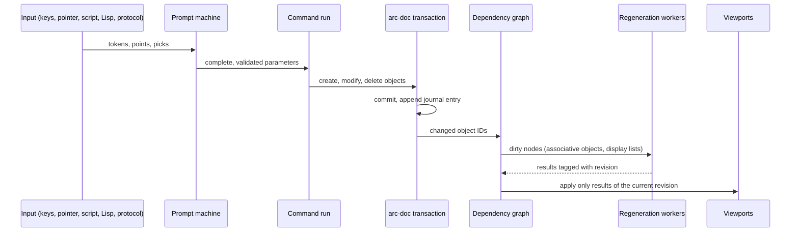

# DraftBuilder architecture overview

This document describes the crates of this repository, how they use the `arc-core` foundation, the
main runtime flows, the product-specific subsystems, threading, performance targets, the automation
surface and the testing strategy. Suite-wide architecture is defined in
[`arc-suite`](https://github.com/ACKaraca/arc-suite) and its
[decision records](https://github.com/ACKaraca/arc-suite/tree/main/docs/adr) and is not repeated here.

## Crates

The repository follows the suite product template. Two crates are added because each has a real
second boundary: the Lisp-dialect interpreter runs in its own process, and toolsets are separately
enabled modules that share one framework.

| Crate | Kind | Responsibility |
|---|---|---|
| `crates/draftbuilder-model` | library, headless | The drawing database: DWG-aligned object types over `arc-draft`, owner tree, handles and stable IDs, symbol tables, dictionaries, extended data, preserved foreign objects, associativity rules (dimensions, hatches, arrays, fields, dynamic blocks, constraints), regeneration nodes, settings and the setting-name compatibility table |
| `crates/draftbuilder-commands` | library, headless | Every user-level command: parameter schema, non-interactive `run`, interactive prompt machine, option keywords, aliases, transparent-command eligibility |
| `crates/draftbuilder-io` | library, headless | Mapping between the drawing database and the neutral models of `arc-io-dwg` and `arc-io-dxf`, and between drawings and other formats (PDF, SVG, raster, IFC, STEP, mesh formats, point clouds, KML); loss reports |
| `crates/draftbuilder-lisp` | library, headless | Reader, evaluator and standard library of the Lisp dialect used by existing drawing routines; drawing access through the automation protocol; dialog definitions (DCL) as a declarative description |
| `crates/draftbuilder-toolset` | library, headless | Toolset framework: typed domain objects with property sets, styles and display representations, schedules, catalogs, projects, degradation to plain entities (phase 4; see [20-toolset-framework.md](../product/capabilities/20-toolset-framework.md)) |
| `crates/draftbuilder-ui` | library | Tools, panels (layers, properties, references, blocks, sheet sets, compare), cursor input, grips, command line integration, DCL dialog rendering |
| `toolsets/<name>` | libraries, headless | One crate per toolset on `draftbuilder-toolset`; created when the toolset starts |
| `apps/draftbuilder` | binary | Desktop application: wiring only |
| `apps/draftbuilder-cli` | binary | Headless CLI: open, convert, validate, audit, plot, publish, compare, run scripts and Lisp files, serve the automation protocol |
| `apps/draftbuilder-lisp` | binary | Out-of-process host for the Lisp interpreter ([ADR-0005](../adr/0005-lisp-interpreter-out-of-process.md)) |
| `apps/draftbuilder-web`, `apps/draftbuilder-mobile` | binaries | Browser (WebAssembly) and tablet and phone entry points: wiring only, on the same crates ([ADR-0007](../adr/0007-web-and-mobile-targets.md)) |
| `apps/draftbuilder-com` | binary, Windows only | Out-of-process automation bridge, a protocol client ([ADR-0008](../adr/0008-windows-integration-crate.md)) |
| `crates/draftbuilder-windows` | library, Windows only | The FFI crate for object linking and the automation server ([ADR-0008](../adr/0008-windows-integration-crate.md)) |

`draftbuilder-lisp` depends on the automation protocol types in `arc-command` only; it never links
the model, which keeps the interpreter replaceable and the process boundary honest.

## Use of `arc-core`

| Crate | Used for |
|---|---|
| `arc-base` | Stable identifiers, units, tolerances, colors (index, true color, color books), errors |
| `arc-geom` | Lines, arcs, ellipses, splines, polylines with bulges, regions and 2D booleans, offsets, intersections for trim, extend, fillet and object snaps, spatial indexes for selection and snapping, hatch boundary detection |
| `arc-mesh` | Polyface and subdivision meshes, mesh editing and smoothing |
| `arc-brep` | Solids and surfaces, booleans, fillets, shells, sections, mass properties, STEP exchange (phase 3) |
| `arc-solve` | 2D geometric and dimensional constraints, the parameter table and expression engine, dynamic-block parameter evaluation |
| `arc-doc` | Object store, transactions, operation journal, undo and redo, dependency graph and regeneration scheduler, external reference resolution, the `.draftb` sidecar package |
| `arc-command` | Command registry, parameter schemas, prompt machines, command-line parsing, macro recording, automation protocol endpoint, headless runner |
| `arc-draft` | Shared drafting model: entities, layers, linetypes, text and fonts, dimensions, hatches, blocks, tables, layouts, plot styles, annotation scaling, the sheet and plot pipeline |
| `arc-view` | Flat projection, hidden-line views and drawing views of 3D content |
| `arc-scene` | Arc Scene export to RenderBuilder |
| `arc-nodes` | Node graphs over commands (phase 4) |
| `arc-io-dwg`, `arc-io-dxf` | Neutral models of the DWG and DXF formats, readers and writers ([dwg-compatibility.md](dwg-compatibility.md)) |
| `arc-io-pdf`, `arc-io-mesh`, `arc-io-step`, `arc-io-ifc`, `arc-io-pointcloud`, `arc-io-geo` | Other formats ([interoperability.md](interoperability.md)) |
| `arc-io-dgn`, `arc-io-3dm` | Open readers for DGN V7 and Rhino 3DM (phase 5) |
| `arc-hub-api` | Opening and saving through Arc Hub, locks, versions, reviews, issues, change sets |
| `arc-gpu` | 2D and 3D viewport, drafting-quality lines, lineweights, hatches, text, picking, point clouds |
| `arc-ui`, `arc-app` | Docking workspace, command line, property grid, trees, palettes, settings, localization, plug-in loading, assistant panel |

## Runtime flows

### Command to view

1. Input arrives as tokens. The prompt machine of the active command interprets them against its
   current prompt (point, distance, keyword, selection) and produces typed parameters. Scripts, Lisp
   routines and the protocol either drive the same prompt machine token by token or call `run` with
   complete parameters.
2. `run` validates parameters and changes the database inside one transaction. A failure rolls the
   transaction back; nothing reaches the journal.
3. The commit records element-level operations with before and after states in the operation
   journal, which drives undo, redo, history, compare and change sets.
4. The dependency graph marks dependents dirty: associative dimensions, hatches, arrays, fields,
   dynamic block representations, constraint systems, toolset objects and display lists.
5. Regeneration runs on worker threads; each result carries the revision it was computed from and is
   discarded if the document moved on. Viewports draw from display lists, never from the database.

### Open and save

Opening reads the file through `arc-io-dwg` or `arc-io-dxf` into a neutral model, maps it into the
drawing database in parallel per block record, keeps unmapped content in the preservation store and
builds a preservation report. Saving maps the database back to the neutral model, merges preserved
content, writes to a temporary file and replaces the target atomically. The sidecar package is
written in the same save. Details are in [dwg-compatibility.md](dwg-compatibility.md).

### Plot and publish

A layout is turned into a sheet description by the shared `arc-draft` sheet pipeline (viewports
clipped and scaled, plot styles resolved, lineweights in paper units) and written by `arc-io-pdf`,
the SVG writer or the raster backend. Plotting runs on a snapshot of the document revision, so editing
continues during background plots.

## Product-specific subsystems

| Subsystem | Crate | Notes |
|---|---|---|
| Drawing database layer | model | Owner tree, handle seed and allocation, symbol tables, dictionaries, reserved records; see [domain-model.md](domain-model.md) |
| Preservation store | model, io | Keeps unknown classes, objects, extended data and unmapped fields with their owner links ([ADR-0003](../adr/0003-lossless-preservation.md)) |
| Associativity engine | model | Regeneration nodes for associative dimensions, hatches, arrays, fields, leaders, center marks, dynamic blocks and constraints |
| Display list builder | model, `arc-gpu` | Curve tessellation, linetype generation, hatch line generation, text shaping including shape fonts, proxy graphics; parallel per block record and tile |
| Command line and prompt machines | commands, ui | See [command-line.md](command-line.md) |
| Settings and compatibility names | model | Typed DraftBuilder settings with scopes (drawing, profile, session) and a table of widely used setting names accepted from scripts, routines and drawings |
| Reference manager | model, io | Path resolution, nested references, cycle detection, demand loading, reload on change |
| Lisp host | lisp | Out-of-process interpreter speaking the automation protocol |
| Toolset framework | toolset | Typed objects stored as custom objects with proxy graphics and plain-entity fallbacks ([ADR-0006](../adr/0006-toolset-objects-degrade-to-entities.md)) |

## Web and mobile targets

The browser, tablet and phone builds compile `draftbuilder-model`, `-commands`, `-io` and
`-toolset` and the same `draftbuilder-ui` for `wasm32`, iOS and Android
([ADR-0007](../adr/0007-web-and-mobile-targets.md)). Platform facilities (files, storage, camera,
location) come through `arc-app`. Each registered command carries a target-availability flag, so
staging from viewing to full 2D editing is a release decision. An offline replica holds the drawing,
its journal and pending change sets; synchronization and shared sessions use `arc-hub-api`.
Components that cannot run on a device, such as the Lisp host, run as Arc Hub jobs.

## Threading and background work

- The UI thread handles input, layout and drawing of the interface; it never waits on the database.
- Each open drawing has one writer: commands run on that document's command thread. Readers
  (regeneration, plotting, saving, compare) work on immutable snapshots, which structural sharing in
  `arc-doc` makes cheap.
- Regeneration, file mapping, hatch generation, text shaping and selection queries over large sets
  run on a shared worker pool, partitioned by block record and spatial tile.
- Background jobs (plotting, publishing, point cloud indexing, reference reloads, audits, saves) are
  cancellable, report progress and apply results only to the revision they started from.
- The Lisp interpreter runs in its own process; a runaway routine is stopped without affecting the
  drawing, and its partial transaction is rolled back.

## Performance targets

Targets are acceptance budgets on a reference workstation defined in the suite engineering standards;
they are design goals, not measurements.

| Target | Budget | Rationale |
|---|---|---|
| Open a 100 MB drawing with 2 million entities | Interactive within 10 s; full regeneration continues in the background | Large survey and site drawings of this size are routine |
| Pan and zoom | 60 frames per second with 5 million visible segments | Navigation must never stall drafting |
| Typical modify command on up to 10,000 objects | Committed and displayed within 100 ms | Keeps keyboard work fluid |
| Regeneration after a single edit | Dependents updated within 50 ms | Associative objects must appear to follow the cursor |
| Object snap and selection preview | Under 8 ms per pointer move | Snapping must keep up with the pointer |
| Save | Not slower than open for the same drawing | Frequent saving must stay cheap |
| Lisp entity access | 20,000 entity reads or writes per second through batched protocol calls | Existing batch routines must stay practical out of process |

## Automation surface

Every capability is reachable through the command registry. The registry is exposed through menus
and panels, the command line, macro recording, scripts, the Lisp interpreter, the Arc Automation
Protocol, the Model Context Protocol endpoint, the Python client, the headless CLI, node graphs
(phase 4) WebAssembly plug-ins (phase 3) and, on Windows, the automation bridge (phase 5). The same commands
run as Arc Hub jobs through the CLI.
See [command-line.md](command-line.md) and
[18-customization-automation.md](../product/capabilities/18-customization-automation.md).

## Implemented in M0

Milestone M0 ([roadmap](../roadmap.md)) built the part of the structure above that proves the
mapping onto `arc-doc` and `arc-draft`. Everything not listed here is still design.

| Part | State |
|---|---|
| Crates | `draftbuilder-model`, `-io`, `-commands`, `apps/draftbuilder` (over the `arc-app` shell, without a `draftbuilder-ui` crate: the viewport, outliner, property grid and command line panels of `arc-app` are enough), `apps/draftbuilder-cli`, `xtask`. The foundation is one pinned revision of `arc-core`. |
| Document type set | The drafting types of `arc-draft`. The drawing database adds no object types. |
| Handles | The bindings are the source map of `arc-doc` that `arc-draft-dxf` writes on import (format `dxf`, document label `drawing`) and reads on export. `draftbuilder-model` is a view over it. |
| High-water mark, fingerprint | `draftbuilder-model` keeps these two as `arc-doc` foreign data rows: the highest handle the drawing has had (the `floor` of the export) and the fingerprint with its origin (file or assigned). Rows are journaled, undone with the commands that wrote them and saved in the package. Rows of deleted objects stay, so a handle is not issued again. |
| Stable IDs | `stable_id` computes the version 5 UUID over the fingerprint and the handle (ADR-0002). Nothing is stored for it, and the journal still addresses objects by their `arc-doc` identifier. |
| Open | `draftbuilder.drawing.open_dxf` reads the file with `arc-io-dxf`, plans the import with `arc-draft-dxf` (source document label `drawing`) and applies it in one undoable transaction; the import binds every object it creates from a file object to its handle. |
| Save | `draftbuilder.drawing.save_dxf` exports the model space with `HandlePolicy::KeepSources` and the high-water mark as floor, keeps the fingerprint (or assigns one and says so in the report), writes a new version GUID on every save and a new fingerprint for an independent copy. Objects the file did not have get handles above the floor; the command records them as bindings in its transaction and raises the mark. |
| Reports | The loss and preservation report of `arc-io-dxf` and `arc-draft-dxf` (which names repeated and reassigned handles) is returned by both commands, with the product item `db.io.fingerprint_assigned`. |
| Move | Superseded: `MOVE` (alias `M`) is `draftbuilder.modify.move` (see the modify section); `core.draft.entity.transform` stays reachable by its identifier. |
| CLI | The shared subcommands of the Arc suite with the product's drafting validators installed on every document and `view.render` answered by the drafting renderer, and `render` (the model space to PNG through `arc_app::render`). A script opens, moves, undoes (`history.undo`) and saves over `serve --stdio --create`. |
| Application | The viewport draws the model space through the drafting extractor of `arc-gpu`. DXF is a native format of the application: a `.dxf` opens and saves through its own open and save path with `open_document` and `save_document`. Shell messages come from the shared catalogs of `arc-app`. |
| Working file | The CLI works on a document package with the extension `draftb`, which holds the drawing database of an opened DXF drawing so that several processes can work on it. The sidecar of [ADR-0001](../adr/0001-drawing-database-is-the-model.md), which accompanies the native `.dxf` file, is not built yet; a `.dxf` opened in the application has no package, no edit lock and no recovery journal. |

Handles that a saved file keeps are those of the layers, linetypes, text styles, block records
(the `BLOCK_RECORD` entries) and the entities of the model space and of blocks that were in the
opened file. Handles it does not keep:

- the `BLOCK` and `ENDBLK` records of blocks, the `TABLE` headers and the `VERTEX` and `SEQEND`
  records of classic polylines, which are not objects of the drafting model (a classic polyline is
  written as a lightweight polyline with the handle of its `POLYLINE` record);
- the viewport, application-name and dimension-style tables, the paper space and model space block
  records, the layouts and the dictionaries, which the export writes itself (the root dictionary
  keeps 0xC unless an object holds it);
- the standard linetypes (`Continuous`, `ByLayer`, `ByBlock`), which the export writes itself when
  the document has no linetype of that name;
- the attribute definitions and attribute values of blocks, paper space entities and objects of
  types `arc-draft` has no object for, except records kept as foreign data, which keep theirs;
- objects of a file that repeats a handle, after the first occurrence.

Known limits of the prototype: undo history does not survive a restart, so `history.undo` works
inside one `serve` session; a save that records handles is a step in the history, and undoing it
forgets the records (the process-wide mark keeps the written handles from being issued to another
object while the process lives, but a later process that opens the package continues from the
lower mark in the document); and one drawing per document: opening a second file into a document
is refused.

### Commands and formats added after M0

| Part | State |
|---|---|
| Vocabulary and name forms | `draftbuilder-commands` holds the typed names and aliases in one table (`vocabulary`), applied to the registry through arc-command's user aliases. One product name resolver (`names::resolver`, installed by `registry()`) reads the prefixes: `_NAME` (the English name), `-NAME` (the prompt form, flag `no_dialogs`) and `.NAME` (the built-in command, flag `builtin_only`, user aliases never consulted). The resolver decides from the name alone: a prefixed identifier resolves to its command whenever the command is registered, including commands registered after the resolver was installed, and the registry reports `cmd.unknown` for one it does not hold. The command line, the protocol, macros, scripts and the CLI `run` subcommand all read them through the registry, and the CLI rewrites nothing. No command reads the flags yet, since none opens a dialog. Completion ignores surrounding whitespace, and the built-in form offers only the names it resolves. See [command-line.md](command-line.md#aliases-and-command-resolution). |
| Open | `draftbuilder.drawing.open` reads a DWG file through `arc-io-dwg` (R13 to R2018, experimental for files that are not trusted) or a DXF file. The content decides the format: a DWG version signature, or the section markers of a DXF; the file name decides only when the content names neither. `draftbuilder.drawing.open_dxf` reads DXF only. The reader's report is merged into the plan's report. |
| Units | An optional `unit` is the drawing's unit. The content is scaled by the factor the DXF mapper applies, and the report carries the mapper's own item: `draft.dxf.units_converted` with the source code and the factor, or `draft.dxf.units_unitless` when nothing is converted. Model-space geometry and text heights are scaled. Block content keeps the unit of its block record; the drafting model converts a reference when it draws. |
| New | `draftbuilder.drawing.new` creates an empty drawing from the metric or imperial default, or from a template drawing (DWG or DXF). A template contributes its layers, linetypes, text styles, dimension styles and unit. Its geometry, blocks, objects, layouts and page setups are not copied, and its handles are not kept. A new drawing has no report. |
| Save | `draftbuilder.drawing.save` and `draftbuilder.drawing.save_dxf` write DXF for versions 2000 to 2018. The target must be a regular file or absent: a symbolic link is refused (`db.cmd.target_not_file`) and never replaced or followed, as before, and a read-only file is refused (`db.cmd.target_read_only`); both are left as they were. The save is refused with `db.cmd.export_drops_objects` (kind and count named) when the export would drop an object of a kind the product creates (an array, for now), and nothing is written; a dropped kind the product does not create is only reported in the loss report. The file is written to a temporary file that `Context::create_new` creates exclusively beside the target under a name with a random part; the temporary file takes the target's permissions on its open handle before any byte is written, is written, synced and closed, and `Context::replace_file` renames it over the target. The bookkeeping (the handles and the marks of the drawing) is recorded once the file is in place; a failed directory sync on Unix after the replace is not an error but a warning in the result (`warnings`). A failed save before the replace removes the temporary file and leaves the target as it was. In the application's native save the application creates the temporary file and the command writes it; the application then renames it over the target without the target's permission bits, a gap listed below. A DWG target is refused, because DWG writing is not available. |
| Audit | `draftbuilder.drawing.audit` reports owner, handle-binding and curve geometry findings. It lists at most the session's record limit and counts the rest. It repairs nothing. |
| Purge | `draftbuilder.drawing.purge` removes unused layers, linetypes, block definitions and styles. With `repeat` it makes passes until nothing more is unused, up to 64 passes; a preview runs the same passes and rolls them back, so it lists what a run removes. Protected names are kept per category: layers `0` and `Defpoints`, linetypes `Continuous`, `ByLayer` and `ByBlock`, and the text style `Standard`. A name that a preserved record of the file contains is kept too. |
| Reports | Open and save return the loss report, which the CLI and the protocol return as JSON ([interoperability.md](interoperability.md#report-format)). |
| Selection | `draftbuilder.select.window`, `crossing`, `window_polygon`, `crossing_polygon`, `fence`, `all`, `last`, `previous`, `filter` (typed `FILTER`) and `similar` return the objects of a space (the model space by default, or any space or block definition named by `space`). Each is a pure function over the snapshot in `select::methods` and `select::query`, with its candidates from `select::candidates`. An entity is tested by its display-list curves with the exact tests of `arc-geom`: inside means every stretch of the curve between its crossings with the boundary lies inside, touching counts, and crossing means any part inside or meeting the boundary. A stroke gives its whole curve, a fill, mask or region its boundary, a block reference all of its flattened primitives, a dimension its strokes and a hatch its boundary and pattern. Text in a stroke font is tested by its curves; text in an outline font by the box of its glyph positions. An entity that is invisible or on an off or frozen layer is never picked; one on a locked layer only with `include_locked`. `previous` applies the same rules to the set it is given, in its order, without repetition. A rectangle with no width or no height is refused (`db.cmd.selection_invalid`). An entity whose display list cannot be built is counted in `skipped` rather than dropped silently. A set argument (`objects`) holds at most 10,000 identifiers and not more than the session's array-length limit (`db.cmd.limit_exceeded`). Names in filters compare with the product's fold (see the layers row). The commands are read-only: they change no document state and create no undo step. The session's current selection is the set `mode` (`replace`, `add`, `remove`) and `within_current` combine with, and the result becomes the session's selection (`Context::set_selection`; the current set becomes the previous one). `previous` is the session's previous selection. `last` is the topmost object (draw order), supplied by the session hook `with_hooks`. The session holds the selection, so a command reads the same set in the protocol, the CLI and the tests. The cycling order of overlapping candidates is a pure function (`select::cycle`). |
| Layers and properties | `draftbuilder.layer.create` (typed `LAYER`) creates a layer; `draftbuilder.layer.rename` renames one. Names are compared by one fold, `fold::fold`: each character is replaced by its uppercase form, one character at a time (`char::to_uppercase`, so `ß` folds to `SS`). The fold does not depend on position, and it does no trimming and no normalization: a leading space is part of a name, and a composed letter differs from its decomposed form. Turkish letters follow the rule without a locale: `çizgi` and `ÇIZGI` are one name, `ÇİZGİ` is another name (dotted `İ` stays `İ`), and `çızgı` (dotless `ı`) is the same name as `çizgi`. Uniqueness on create and rename, lookup by name, the protected names of purge and the values of selection filters all use this fold, so they agree. Layer `0` and `Defpoints`, in any letter case, cannot be renamed, deleted or merged away (`db.cmd.layer_special`). A layer named by a preserved record of the file keeps its name, by purge's rule (a name that a preserved record contains): rename, delete, delete with contents and merge refuse it (`db.cmd.layer_preserved`). `draftbuilder.layer.delete` removes unused layers; any object that refers to the layer, an entity or a viewport's layer override, refuses it with `db.cmd.layer_in_use`, naming the kind of the referrer. `draftbuilder.layer.delete_with_contents` (`LAYDEL`) removes a layer with every object on it, including objects inside block definitions; it refuses a locked layer that has contents, and it refuses when a dependent object outside the removal sits on a locked layer, because a dimension follows its geometry and would be rewritten. `draftbuilder.layer.merge` (`LAYMRG`) moves the objects of source layers, including block content, to a target and removes the sources; it refuses a locked source or a locked target when the sources have contents, and then nothing changes. Edits to objects on a locked layer are refused with the foundation's `draft.layer.locked`: the foundation's commands refuse them, and the product's commands that write entities directly (property change and match, layer change and match) apply the same one-line rule, because the foundation's check is not public. A property match also refuses a locked source layer, since the copy moves the destinations onto it. `draftbuilder.layer.modify` sets the flags, color, linetype, lineweight, transparency and description of layers; `draftbuilder.layer.on`, `off`, `freeze`, `thaw`, `lock` and `unlock` (typed `LAYON`, `LAYOFF`, `LAYFRZ`, `LAYTHW`, `LAYLCK`, `LAYULK`) act on the layers of chosen objects; `draftbuilder.layer.change` and `match` (`LAYMCH`) move objects to a named layer or to the layer of a source. `draftbuilder.property.change` (typed `CHPROP`, `CHANGE`) and `draftbuilder.property.match` (`MATCHPROP`) set and copy the layer and appearance of objects, with their sources (ByObject, ByLayer or ByBlock). Colors are index colors with their source kept; transparency of a layer is limited to 90 percent. `LINETYPE` is the typed name of `core.draft.linetype.load`. A new drawing holds layer `0`; opening a file without one creates it, and the report carries `db.io.layer_zero_created`. Opening a file whose layer names differ only by case reports the number of such groups (`db.io.layer_name_case_duplicate`): the importer reads each group as one layer. The header variable `$CLAYER` is not stored: the product's save writes only the fingerprint, version GUID and handle seed, and the foundation's export writes `$INSUNITS` and `$HANDSEED`, so a rename cannot leave a stale current-layer name, and there is no current layer to refuse to delete. Each command writes its fields in one transaction, so it is one undo step. Layer 0 of a new drawing gets a handle on save and keeps it on the next save. |

Not implemented yet in selection and layers: picking, grips, highlight and the selection prompt machine (the prompt keywords and the mode switches); implicit windowing; groups; selection isolation and hiding; selection by name of a saved filter; properties by size; the noun-verb use of a selection; layer states; layer isolation; the current layer; layer walk; setting viewport layer overrides (the product refuses to delete a layer they name, but has no command that sets them); the panels. The foundation (pinned `arc-core` at 849f448) lacks: no selection record for a transaction without operations (`arc-command` protocol `run.rs` and `arc-doc` `commit.rs`); `arc-command` caps a session selection at 10,000 identifiers (`protocol/events.rs`, `MAX_SELECTED`); no hook for `last` in the protocol server or in the application's own UI session (`arc-command` `protocol/mod.rs`, `ServerConfig::session`; `arc-app` `application.rs`, `default_session`), so `last` works where the product builds the session (`draftbuilder_commands::with_hooks`); the commit name check compares bytes (`arc-draft` `validate.rs`; the product checks names by its fold on create and rename); no creation order for `last` beyond the draw order of the model space (the `arc-doc` handle orders storage slots, `store.rs`); outline text exposes glyph positions only (`arc-draft` `display.rs`, `Shape::Glyphs`); the layer lock check is not public (`arc-draft` `lock.rs`), so the product repeats its rule for the entities it writes directly.

### Drawing commands (Phase-1 rows of DB-DRAW)

The drawing commands are the `draftbuilder.draw.*` family in `draftbuilder-commands` (`draw`, one
module per family, pure constructions in `draw/geometry.rs`, shared creation in `draw/create.rs`).
Each command has typed parameters for the complete form and a prompt machine for the typed form.
Each command ends in one transaction: a command that creates several entities (LINE, PLINE with
its segments, RECTANG with fillet) is one undo step. Points typed or picked in a prompt go through
the foundation's point entry, so `x,y`, `@x,y`, `@d<a`, `d<a`, the direction lock `<a` and direct
distances after a pointer direction are read by the foundation. Prompt defaults are shown in angle
brackets. The prompt form has no preview (the rubber band is not built).

New entities go to the model space on layer `0` with the by-layer appearance defaults of the
foundation. The drawing's current layer and current properties are not built yet; `Creator::new`
is the one place that will read them. Coordinates in the typed parameters are numbers in the
drawing's units (the unit of its model space); a unitless drawing takes meters. Prompt answers are
converted to the same units. Angles are radians, counterclockwise from the positive x axis; the
prompt form reads a bare angle with the session's angle context unit (degrees).

| Capability ([rows of 05-draw-2d](../product/capabilities/05-draw-2d.md)) | Command (typed name) | Built | Not built |
|---|---|---|---|
| Line | `draftbuilder.draw.line` (`LINE`) | Chain of separate lines; close; undo; finish; typed and prompt forms | Continuation from the end of an arc (the last point, given with `@`, continues from a line) |
| Construction line | `draftbuilder.draw.xline` (`XLINE`) | Through two points; horizontal; vertical; angle through a point; repeats until finish; undo | Bisector and offset options (they need a picked line or angle) |
| Ray | `draftbuilder.draw.ray` (`RAY`) | One ray per through point; undo | None |
| Polyline | `draftbuilder.draw.polyline` (`PLINE`) | Line and arc segments; per-segment start and end widths; undo; close with a straight segment; arc methods second point, center, included angle, radius, direction; tangent continuation | Length continuation; half-width option; closing with an arc; the typed form takes bulges, not arc parameters |
| Rectangle | `draftbuilder.draw.rectangle` (`RECTANG`) | Corners; rotation and corner; dimensions and area with the side point choosing the quadrant; typed width and fillet radius (the foundation's corner fillet) | Chamfers; elevation and thickness (default 0); width and fillet in the prompt form |
| Polygon | `draftbuilder.draw.polygon` (`POLYGON`) | 3 to 1024 sides, inscribed, circumscribed, by an edge | None |
| 3D polyline | 3D polyline (`3DPOLY`) | Not built | No 3D polyline entity in `arc-draft` |
| Legacy polylines | Legacy polylines | Read and written through DXF import, as lightweight polylines | Read-back as legacy objects; the conversion command |
| Circle | `draftbuilder.draw.circle` (`CIRCLE`) | Center and radius; center and diameter; two points; three points; tangent to two objects with a radius (typed: lines, segments and circles, with the object identifier and a pick point) | Tangent to three objects; tangent to arcs and polylines; the pick in the prompt form |
| Arc | `draftbuilder.draw.arc` (`ARC`) | Three points; start, center and end; start, center and angle; start, end and radius; start, end and angle | Continuation from the last line or arc; chord length; the typed form and prompt form of the continuation |
| Ellipse | `draftbuilder.draw.ellipse` (`ELLIPSE`) | Axis endpoints and other semi-axis; center and semi-axis; rotation about an axis (minor semi-axis is the radius times the cosine of the rotation); elliptical arcs by start and end parameters | Isometric circles; rotation in the axis form |
| Donut | `draftbuilder.draw.donut` (`DONUT`) | Rings at repeated centers; inside diameter zero gives a disc | Fill display (a setting) |
| Spline | `draftbuilder.draw.spline` (`SPLINE`) | Fit points (degree 3 in the prompt form); control vertices with a degree (typed) | Fit tolerance; end tangents; converting spline-fit polylines; control vertices in the prompt form |
| Helix | Helix (`HELIX`) | Not built | No helix entity or sweep path in `arc-draft` |
| Point | `draftbuilder.draw.point` (`POINT`) | Point entities at positions; repeats until finish | The drawing-wide point style (a setting) |
| Divide, measure | Divide, measure | Not built | Need a picked curve and a block choice; the interval walk is not wired |
| Sketch | Sketch | Not built | Needs the pointer's free movement |
| Region, boundary | Region, boundary | Not built | Need selected loops or a picked point and the island detection, which are not wired into a command |
| Wipeout | Wipeout | Not built | The foundation has a wipeout creation function; not wired into this family |
| Revision cloud | Revision cloud | Not built | No revision-cloud construction in the foundation |
| 2D solid and trace; fill display | 2D solid and trace; fill display | Not built | No trace or solid entity in the type set; fill display is a setting |
| Multiline and multiline styles | Multiline and multiline styles | Not built | No multiline types in `arc-draft` |

The Phase-2 and Phase-3 rows of the capability document are not part of this family.

Not implemented yet: a read-only open and an initial view; DWG writing and save as DWG; DXF writing
for R12 to R14; the DWG fingerprint and handle seed, which `arc-io-dwg` does not carry (a DWG drawing
gets an assigned fingerprint, and its handle mark is the highest bound handle, not the file's seed);
the directory sync on Windows; the independent-reader check in continuous integration; the
status-bar indicator; a human-readable report beside the JSON; placement of imports by insertion point
or geographic location; audit repairs; purge of empty text and of application names; layouts and page
setups of templates; scaling of linetype pattern lengths on unit conversion (the DXF mapping does not
scale them yet, see arc-core).

### Modify commands (Phase-1 rows of DB-MOD)

The modify commands are the `draftbuilder.modify.*` family in `draftbuilder-commands`, one module per
family under `modify/` (`transform`, `erase`, `array`, `explode`, `stretch`, `trim`, `offset`, `corner`,
`breaking`, `join`, `lengthen`). Each command has a typed form and a prompt machine that ends in the same
invocation, so one invocation is one undo step. The product's own writes apply the foundation's rules:
entities on a locked layer are refused with `draft.layer.locked`, and a copy of an entity that refers to
another entity (a dimension, a hatch boundary, a path array) is refused with `db.cmd.copy_associated`.
Transforms go through the foundation's entity transform (`arc_draft::apply_entity_transform`), so the
foundation's refusals (associated objects, text mirror, kinds that cannot take a transform) pass through
with their own codes. Geometry changes use `arc-geom` (`trim`, `extend`, `split_at_parameters`, `offset`,
`fillet`, `chamfer`, `join`, the polyline corners).

| Capability ([rows of 06-modify-2d](../product/capabilities/06-modify-2d.md)) | Command (typed name, alias) | Built | Not built |
|---|---|---|---|
| Move | `draftbuilder.modify.move` (`MOVE`, `M`) | A displacement, or a base point and a second point; in place | Drag; rubber band |
| Copy | `draftbuilder.modify.copy` (`COPY`, `CO`) | Copies to one or several target points (single, multiple); the source stays. Objects times targets must fit the session array limit (`db.cmd.limit_exceeded`), and every point must be finite, both checked before any copy | The array-of-count copy (spaced or fitted) |
| Rotate | `draftbuilder.modify.rotate` (`ROTATE`, `RO`) | An angle or a reference pair; the copy option | Picked reference points |
| Scale | `draftbuilder.modify.scale` (`SCALE`, `SC`) | A factor or a reference length; the copy option | Picked reference points |
| Mirror | `draftbuilder.modify.mirror` (`MIRROR`, `MI`) | Across two points, keeping or erasing the source | The text reading-direction setting (text is refused by the foundation) |
| Stretch | `draftbuilder.modify.stretch` (`STRETCH`, `S`) | Entities inside the window move as a whole; lines, polylines and arcs that the window crosses change at the points inside it (an arc through its moved end, its other end and its midpoint). Locked entities that the window moves or crosses are refused with `draft.layer.locked`. A stretched arc that would turn the other way is refused (`db.cmd.stretch_unsupported`, reason `direction`). Finite inputs only | Splines, hatches, dimensions, block references; circles and other crossed kinds are refused (`db.cmd.stretch_unsupported`) |
| Align | `draftbuilder.modify.align` (`ALIGN`, `AL`) | One, two or three pairs, a similarity (scale option); three pairs must agree | Three-dimensional alignment |
| Reference input | Reference input of rotate and scale | Typed reference values (angles, lengths) | Picked points as reference values |
| Drag-and-drop editing | Drag-and-drop editing | Not built | Pointer gestures |
| Trim | `draftbuilder.modify.trim` (`TRIM`, `TR`) | Edges given or the visible objects (quick mode, read once per command); extended edges; several targets, each with its pick. The edges are the drawing as it was when the command started, so target order does not matter. A target that cannot be processed is rolled back and listed in `skipped` with its error code; the command fails with the first error only when no target changed. A split keeps the first part and creates the rest | Three-dimensional projection; the erase option; the Shift switch |
| Extend | `draftbuilder.modify.extend` (`EXTEND`, `EX`) | As trim: edges given or quick mode, extended edges, several targets with skipped ones listed; the end nearest the pick is lengthened | Three-dimensional projection; the Shift switch |
| Lengthen | `draftbuilder.modify.lengthen` (`LENGTHEN`, `LEN`) | Segments and arcs by delta, percentage or total, from the end nearest the pick; an arc whose sweep would reach a full turn is refused (`db.cmd.value_invalid`); finite inputs only | Dynamic drag; the angle form; polylines, splines and ellipses |
| Break | `draftbuilder.modify.break` (`BREAK`, `BR`) | Two points (a circle breaks counterclockwise from the first point); one point (split). Points closer than the tolerance are one point and are refused; a point at an end of an open entity is refused (`db.cmd.pick_invalid`, nothing to break) | A circle split at one point becomes an arc (the circle is replaced); a break that needs the closed entity kept whole is not offered |
| Join | `draftbuilder.modify.join` (`JOIN`, `J`) | Entities that touch end to end, built from their oriented chain: pieces that run the same way merge into one segment, arcs on one circle that turn the same way merge into one arc (a full turn into a circle), any other chain becomes its exact polyline, so folds and overlaps keep their length. A single open polyline whose ends touch is closed. Entities that join with nothing are reported in `unjoined` | Helices and three-dimensional joins |
| Fillet | `draftbuilder.modify.fillet` (`FILLET`, `F`) | Two entities with picks, trimmed or kept; radius zero; parallel lines by the foundation's semicircle; the polyline form at every vertex | Multiple mode; the Shift pick |
| Chamfer | `draftbuilder.modify.chamfer` (`CHAMFER`, `CHA`) | Two entities with two distances (typed also: a distance and an angle); the polyline form | The prompt form of distance and angle; multiple mode; the method option |
| Blend | Blend | Not built | The foundation has no blend construction |
| Offset | `draftbuilder.modify.offset` (`OFFSET`, `O`) | A distance with a side point, or a through point; erase source. Polyline corners are mitered up to 4 offsets and beveled beyond that (named `MITER_LIMIT`). Rays and construction lines offset through their own parallel constructions. A side point on the entity is refused (`db.cmd.pick_invalid`), since it picks no side | The layer option; repeated offsets from the last result; the remembered distance; multiple mode |
| Polyline edit | Polyline edit (PEDIT) | Not built | Vertex insertion, moving, width and fit editing need vertex picks and a sub-option prompt machine, which are not in the product yet |
| Spline edit | Spline edit (SPLINEDIT) | Not built | Fit and control vertex editing needs the vertex grips and the spline option prompts, which are not in the product yet |
| Reverse direction | Reverse direction | Not built | The vertex order of lines, polylines and splines is not reversed yet (no command) |
| Rectangular array | `draftbuilder.modify.array_rect` (`ARRAYRECT`) | Rows and columns (each at least one, at most 10,000 items in all, checked at run time), spacings and an angle. The sources must not be referenced by an entity outside them (`db.cmd.array_dependent`) and must share one owner (`db.cmd.array_owner_mixed`); the array is created in that owner. Associative, as a block with the array inserting it | Independent objects; the prompt form of the angle is the default zero |
| Polar array | `draftbuilder.modify.array_polar` (`ARRAYPOLAR`) | Count (1 to 10,000), total angle and turning of items, with the same source rules as the rectangular array | Rows and levels; independent objects; the prompt form does not ask for the turning |
| Path array | `draftbuilder.modify.array_path` (`ARRAYPATH`) | A path entity (which must not be a source) with a count (1 to 10,000) or a spacing; alignment with the path; the source rules of the rectangular array | Divide and measure as separate prompts; the prompt form takes a count only |
| Array editing | Array editing (ARRAYEDIT) | Not built | Parameter, source and item editing needs the array grips and an edit prompt machine, which are not in the product yet |
| Array storage compatibility | Arrays are stored as the foundation stores them, with a block definition holding the items. The DXF export has no array mapping, so a save that would drop an array is refused with `db.cmd.export_drops_objects` (kind and count named) and nothing is written | Exploding an array is refused |
| Erase | `draftbuilder.modify.erase` (`ERASE`, `E`) | Erases entities on unlocked layers; an entity another entity refers to is refused (`db.cmd.erase_dependent`) unless that entity is erased too. The refusal is part of every erase: trim, break, join, offset, mirror and explode erase through the same check; undo restores the erased entities | The restore-last-erased command (undo covers it) |
| Explode | `draftbuilder.modify.explode` (`EXPLODE`, `X`) | Polylines without widths into lines and arcs; block references into their entities, placed by the reference (uniform scale, or a scale that differs only in sign). A by-block component takes the reference's effective value: the reference's own value, or, when the reference is by-layer, the value of the reference's layer, written explicitly because the component keeps its own layer. Layer-0 components take the reference's layer | Arrays, dimensions, hatches, text, tables, leaders and regions are refused with `db.cmd.explode_unsupported`; block attribute values are refused |
| Property-controlled explode | Property-controlled explode | Not built | The appearance option of the components is not written yet (no command) |
| Duplicate removal | Duplicate removal (OVERKILL) | Not built | The tolerance merge of overlapping and collinear entities is not written yet (no command) |
| Flatten | Flatten | Not built | The projection of curves to the UCS plane is not written yet (no command) |
| Change | Change (CHANGE) | Not built | The change-point prompts for endpoints, radius and text are not written yet (no command) |
| Geometry cleanup | Geometry cleanup | Phase 2 | Phase 2 |

A copy keeps the stored values of its source: its layer, its appearance and the fields of its kind. A block
reference keeps its block definition and its attribute values (the attributes are values of the reference,
not separate entities), so the copy inserts the same definition. A kind that refers to another entity
(a dimension, a hatch with a boundary, a path array) is refused with `db.cmd.copy_associated`, because the
copy would keep pointing at the source's entities.

Replace or create, per command. The rule for the pieces of a changed geometry: the first piece of the
source's own kind keeps the identifier and handle and replaces the geometry in place; every other piece is
created. When no piece has the source's kind, the source is replaced by new entities and erased. A created
piece of the source's kind keeps every stored field of the source except its geometry (a polyline keeps its
pattern flag and vertices' widths); a piece of another kind takes the common fields (layer and appearance).
A created piece belongs to the source's owner (its space or block) and takes a draw order just after the
source's. Erasing an entity that another entity refers to is refused wherever it happens (`db.cmd.erase_dependent`).

| Command | Rule |
|---|---|
| MOVE, ROTATE, SCALE, ALIGN, STRETCH, LENGTHEN | In place; the identifiers stay |
| COPY, ROTATE/SCALE with copy, MIRROR | Copies are created; the sources stay (MIRROR with erase: the sources are erased) |
| TRIM, EXTEND | In place for the first piece of the source's kind; the other pieces are created beside the source; a trimmed-away entity is erased. Other targets of the same command are processed on the drawing as it was at the start |
| BREAK | The first piece of the source's kind keeps the identifier; the other pieces are created beside the source; a circle that breaks becomes an arc: the circle is replaced (refused if another entity refers to it) |
| FILLET, CHAMFER | The joint is created; the inputs are trimmed in place (kept with the trim option off); polyline forms in place |
| OFFSET | Copies are created; the sources are erased with the erase option |
| JOIN | The member of the chain with the lowest position in the selection keeps the identifier when the result has its kind (otherwise the result is a new entity); the other members are erased |
| EXPLODE | Components are created; the source is erased |
| ERASE | Entities are erased |
| ARRAY_RECT, ARRAY_POLAR, ARRAY_PATH | The sources move into a new anonymous block definition, and the array is created in the sources' owner |

Known limits of the family: a command does not update dependent entities the foundation does not
regenerate; the prompt forms ask the points and values listed above, and the typed forms take the rest.
The foundation gaps the family meets: the DXF export has no array mapping (`arc-draft-dxf`, export), so the save refuses a drawing with an array until the export maps arrays, which the foundation is to provide;
`arc-draft` `lock.rs` is not public, so the product repeats the rule; the entity delete (`core.draft.entity.delete`)
is not callable from a product command, so the product's erase applies the transaction's delete rules itself and
refuses dependents that are not erased; the foundation's transform is a uniform scale and a mirror, so a
block reference with a non-uniform scale cannot be exploded.

## Testing strategy

- **Round-trip corpus.** DWG and DXF files from the suite corpus repositories, each with owner,
  license and checksum, are opened and saved; object counts, handles, preserved content and geometry
  are compared, and an independent reader checks every written file
  ([dwg-compatibility.md](dwg-compatibility.md)).
- **Fuzzing.** The DWG and DXF readers, the Lisp reader, the alias, linetype, pattern, plot style
  and shape-font parsers are fuzzed continuously; every crash fix adds a regression input.
- **Command scripts.** Behavior is specified as script tests: a starting drawing, a sequence of
  command-line tokens, and expected database state, so interactive and non-interactive paths are
  tested by the same files.
- **Plot comparison.** Plotted sheets are rasterized and compared with reference images at fixed
  resolution, on all three platforms.
- **Lisp conformance.** A suite of routines covers each supported function with expected results.
- **Performance budgets.** The targets above run as benchmarks in CI and fail the build when exceeded
  by the configured margin.
- **Accessibility and localization.** Tests check accessible names, keyboard reachability and that
  every user-visible string comes from a message catalog.
