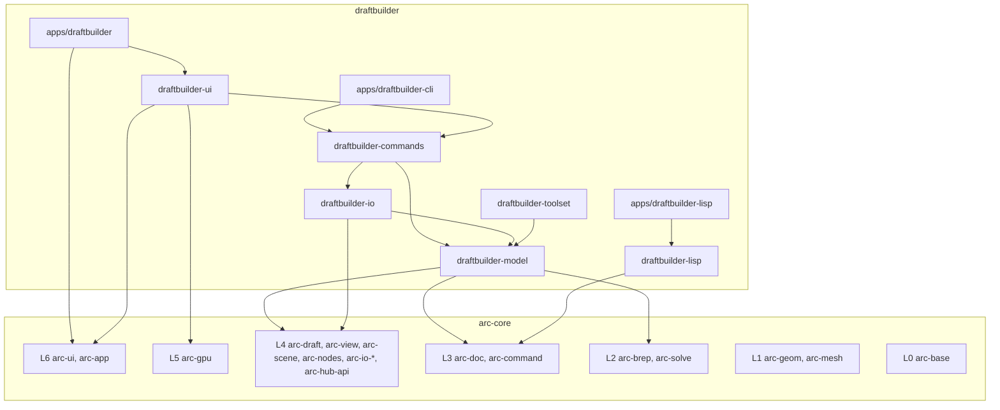
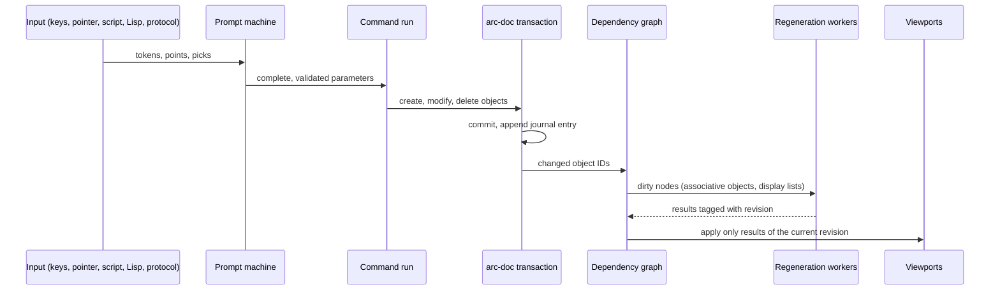

# DraftBuilder architecture overview

This document describes the crates of this repository, how they use the `arc-core` foundation, the
main runtime flows, the product-specific subsystems, threading, performance targets, the automation
surface and the testing strategy. Suite-wide architecture is defined in
[`arc-suite`](https://github.com/ACKaraca/arc-suite) and its
[decision records](https://github.com/ACKaraca/arc-suite/tree/main/docs/adr) and is not repeated here.

## Crates

The repository follows the suite product template. Two crates are added because each has a real
second boundary: the Lisp-dialect interpreter runs in its own process, and toolsets are separately
enabled modules that share one framework.

| Crate | Kind | Responsibility |
|---|---|---|
| `crates/draftbuilder-model` | library, headless | The drawing database: DWG-aligned object types over `arc-draft`, owner tree, handles and stable IDs, symbol tables, dictionaries, extended data, preserved foreign objects, associativity rules (dimensions, hatches, arrays, fields, dynamic blocks, constraints), regeneration nodes, settings and the setting-name compatibility table |
| `crates/draftbuilder-commands` | library, headless | Every user-level command: parameter schema, non-interactive `run`, interactive prompt machine, option keywords, aliases, transparent-command eligibility |
| `crates/draftbuilder-io` | library, headless | Mapping between the drawing database and the neutral models of `arc-io-dwg` and `arc-io-dxf`, and between drawings and other formats (PDF, SVG, raster, IFC, STEP, mesh formats, point clouds, KML); loss reports |
| `crates/draftbuilder-lisp` | library, headless | Reader, evaluator and standard library of the Lisp dialect used by existing drawing routines; drawing access through the automation protocol; dialog definitions (DCL) as a declarative description |
| `crates/draftbuilder-toolset` | library, headless | Toolset framework: typed domain objects with property sets, styles and display representations, schedules, catalogs, projects, degradation to plain entities (phase 4; see [20-toolset-framework.md](../product/capabilities/20-toolset-framework.md)) |
| `crates/draftbuilder-ui` | library | Tools, panels (layers, properties, references, blocks, sheet sets, compare), cursor input, grips, command line integration, DCL dialog rendering |
| `toolsets/<name>` | libraries, headless | One crate per toolset on `draftbuilder-toolset`; created when the toolset starts |
| `apps/draftbuilder` | binary | Desktop application: wiring only |
| `apps/draftbuilder-cli` | binary | Headless CLI: open, convert, validate, audit, plot, publish, compare, run scripts and Lisp files, serve the automation protocol |
| `apps/draftbuilder-lisp` | binary | Out-of-process host for the Lisp interpreter ([ADR-0005](../adr/0005-lisp-interpreter-out-of-process.md)) |
| `apps/draftbuilder-web`, `apps/draftbuilder-mobile` | binaries | Browser (WebAssembly) and tablet and phone entry points: wiring only, on the same crates ([ADR-0007](../adr/0007-web-and-mobile-targets.md)) |
| `apps/draftbuilder-com` | binary, Windows only | Out-of-process automation bridge, a protocol client ([ADR-0008](../adr/0008-windows-integration-crate.md)) |
| `crates/draftbuilder-windows` | library, Windows only | The FFI crate for object linking and the automation server ([ADR-0008](../adr/0008-windows-integration-crate.md)) |

`draftbuilder-lisp` depends on the automation protocol types in `arc-command` only; it never links
the model, which keeps the interpreter replaceable and the process boundary honest.

## Use of `arc-core`

| Crate | Used for |
|---|---|
| `arc-base` | Stable identifiers, units, tolerances, colors (index, true color, color books), errors |
| `arc-geom` | Lines, arcs, ellipses, splines, polylines with bulges, regions and 2D booleans, offsets, intersections for trim, extend, fillet and object snaps, spatial indexes for selection and snapping, hatch boundary detection |
| `arc-mesh` | Polyface and subdivision meshes, mesh editing and smoothing |
| `arc-brep` | Solids and surfaces, booleans, fillets, shells, sections, mass properties, STEP exchange (phase 3) |
| `arc-solve` | 2D geometric and dimensional constraints, the parameter table and expression engine, dynamic-block parameter evaluation |
| `arc-doc` | Object store, transactions, operation journal, undo and redo, dependency graph and regeneration scheduler, external reference resolution, the `.draftb` sidecar package |
| `arc-command` | Command registry, parameter schemas, prompt machines, command-line parsing, macro recording, automation protocol endpoint, headless runner |
| `arc-draft` | Shared drafting model: entities, layers, linetypes, text and fonts, dimensions, hatches, blocks, tables, layouts, plot styles, annotation scaling, the sheet and plot pipeline |
| `arc-view` | Flat projection, hidden-line views and drawing views of 3D content |
| `arc-scene` | Arc Scene export to RenderBuilder |
| `arc-nodes` | Node graphs over commands (phase 4) |
| `arc-io-dwg`, `arc-io-dxf` | Neutral models of the DWG and DXF formats, readers and writers ([dwg-compatibility.md](dwg-compatibility.md)) |
| `arc-io-pdf`, `arc-io-mesh`, `arc-io-step`, `arc-io-ifc`, `arc-io-pointcloud`, `arc-io-geo` | Other formats ([interoperability.md](interoperability.md)) |
| `arc-io-dgn`, `arc-io-3dm` | Open readers for DGN V7 and Rhino 3DM (phase 5) |
| `arc-hub-api` | Opening and saving through Arc Hub, locks, versions, reviews, issues, change sets |
| `arc-gpu` | 2D and 3D viewport, drafting-quality lines, lineweights, hatches, text, picking, point clouds |
| `arc-ui`, `arc-app` | Docking workspace, command line, property grid, trees, palettes, settings, localization, plug-in loading, assistant panel |

## Runtime flows

### Command to view

1. Input arrives as tokens. The prompt machine of the active command interprets them against its
   current prompt (point, distance, keyword, selection) and produces typed parameters. Scripts, Lisp
   routines and the protocol either drive the same prompt machine token by token or call `run` with
   complete parameters.
2. `run` validates parameters and changes the database inside one transaction. A failure rolls the
   transaction back; nothing reaches the journal.
3. The commit records element-level operations with before and after states in the operation
   journal, which drives undo, redo, history, compare and change sets.
4. The dependency graph marks dependents dirty: associative dimensions, hatches, arrays, fields,
   dynamic block representations, constraint systems, toolset objects and display lists.
5. Regeneration runs on worker threads; each result carries the revision it was computed from and is
   discarded if the document moved on. Viewports draw from display lists, never from the database.

### Open and save

Opening reads the file through `arc-io-dwg` or `arc-io-dxf` into a neutral model, maps it into the
drawing database in parallel per block record, keeps unmapped content in the preservation store and
builds a preservation report. Saving maps the database back to the neutral model, merges preserved
content, writes to a temporary file and replaces the target atomically. The sidecar package is
written in the same save. Details are in [dwg-compatibility.md](dwg-compatibility.md).

### Plot and publish

A layout is turned into a sheet description by the shared `arc-draft` sheet pipeline (viewports
clipped and scaled, plot styles resolved, lineweights in paper units) and written by `arc-io-pdf`,
the SVG writer or the raster backend. Plotting runs on a snapshot of the document revision, so editing
continues during background plots.

## Product-specific subsystems

| Subsystem | Crate | Notes |
|---|---|---|
| Drawing database layer | model | Owner tree, handle seed and allocation, symbol tables, dictionaries, reserved records; see [domain-model.md](domain-model.md) |
| Preservation store | model, io | Keeps unknown classes, objects, extended data and unmapped fields with their owner links ([ADR-0003](../adr/0003-lossless-preservation.md)) |
| Associativity engine | model | Regeneration nodes for associative dimensions, hatches, arrays, fields, leaders, center marks, dynamic blocks and constraints |
| Display list builder | model, `arc-gpu` | Curve tessellation, linetype generation, hatch line generation, text shaping including shape fonts, proxy graphics; parallel per block record and tile |
| Command line and prompt machines | commands, ui | See [command-line.md](command-line.md) |
| Settings and compatibility names | model | Typed DraftBuilder settings with scopes (drawing, profile, session) and a table of widely used setting names accepted from scripts, routines and drawings |
| Reference manager | model, io | Path resolution, nested references, cycle detection, demand loading, reload on change |
| Lisp host | lisp | Out-of-process interpreter speaking the automation protocol |
| Toolset framework | toolset | Typed objects stored as custom objects with proxy graphics and plain-entity fallbacks ([ADR-0006](../adr/0006-toolset-objects-degrade-to-entities.md)) |

## Web and mobile targets

The browser, tablet and phone builds compile `draftbuilder-model`, `-commands`, `-io` and
`-toolset` and the same `draftbuilder-ui` for `wasm32`, iOS and Android
([ADR-0007](../adr/0007-web-and-mobile-targets.md)). Platform facilities (files, storage, camera,
location) come through `arc-app`. Each registered command carries a target-availability flag, so
staging from viewing to full 2D editing is a release decision. An offline replica holds the drawing,
its journal and pending change sets; synchronization and shared sessions use `arc-hub-api`.
Components that cannot run on a device, such as the Lisp host, run as Arc Hub jobs.

## Threading and background work

- The UI thread handles input, layout and drawing of the interface; it never waits on the database.
- Each open drawing has one writer: commands run on that document's command thread. Readers
  (regeneration, plotting, saving, compare) work on immutable snapshots, which structural sharing in
  `arc-doc` makes cheap.
- Regeneration, file mapping, hatch generation, text shaping and selection queries over large sets
  run on a shared worker pool, partitioned by block record and spatial tile.
- Background jobs (plotting, publishing, point cloud indexing, reference reloads, audits, saves) are
  cancellable, report progress and apply results only to the revision they started from.
- The Lisp interpreter runs in its own process; a runaway routine is stopped without affecting the
  drawing, and its partial transaction is rolled back.

## Performance targets

Targets are acceptance budgets on a reference workstation defined in the suite engineering standards;
they are design goals, not measurements.

| Target | Budget | Rationale |
|---|---|---|
| Open a 100 MB drawing with 2 million entities | Interactive within 10 s; full regeneration continues in the background | Large survey and site drawings of this size are routine |
| Pan and zoom | 60 frames per second with 5 million visible segments | Navigation must never stall drafting |
| Typical modify command on up to 10,000 objects | Committed and displayed within 100 ms | Keeps keyboard work fluid |
| Regeneration after a single edit | Dependents updated within 50 ms | Associative objects must appear to follow the cursor |
| Object snap and selection preview | Under 8 ms per pointer move | Snapping must keep up with the pointer |
| Save | Not slower than open for the same drawing | Frequent saving must stay cheap |
| Lisp entity access | 20,000 entity reads or writes per second through batched protocol calls | Existing batch routines must stay practical out of process |

The targets remain design goals until they are measured on reference hardware. The hidden `bench`
subcommand of `draftbuilder-cli` times what it can headless: it builds a drawing of a given size and seed
through the drawing commands, saves and opens it, and times the modify commands with their undo and redo
(`cargo run --release -p draftbuilder-cli -- bench --entities 100000 --work <dir> [--format json]`). It
is not part of `cargo xtask ci` and asserts no time. Pan and zoom, snapping and Lisp access are not
measured by it.

## Automation surface

Every capability is reachable through the command registry. The registry is exposed through menus
and panels, the command line, macro recording, scripts, the Lisp interpreter, the Arc Automation
Protocol, the Model Context Protocol endpoint, the Python client, the headless CLI, node graphs
(phase 4) WebAssembly plug-ins (phase 3) and, on Windows, the automation bridge (phase 5). The same commands
run as Arc Hub jobs through the CLI.
See [command-line.md](command-line.md) and
[18-customization-automation.md](../product/capabilities/18-customization-automation.md).

## Implemented in M0

Milestone M0 ([roadmap](../roadmap.md)) built the part of the structure above that proves the
mapping onto `arc-doc` and `arc-draft`. Everything not listed here is still design.

| Part | State |
|---|---|
| Crates | `draftbuilder-model`, `-io`, `-commands`, `apps/draftbuilder` (over the `arc-app` shell, without a `draftbuilder-ui` crate: the viewport, outliner, property grid and command line panels of `arc-app` are enough), `apps/draftbuilder-cli`, `xtask`. The foundation is one pinned revision of `arc-core`. |
| Document type set | The drafting types of `arc-draft`. The drawing database adds no object types. |
| Handles | The bindings are the source map of `arc-doc` that `arc-draft-dxf` writes on import (format `dxf`, document label `drawing`) and reads on export. `draftbuilder-model` is a view over it. |
| High-water mark, fingerprint | `draftbuilder-model` keeps these two as `arc-doc` foreign data rows: the highest handle the drawing has had (the `floor` of the export) and the fingerprint with its origin (file or assigned). Rows are journaled, undone with the commands that wrote them and saved in the package; the rows a save records are the exception, which no undo covers. Rows of deleted objects stay, so a handle is not issued again, and bind the object again when undo or redo brings it back. |
| Stable IDs | `stable_id` computes the version 5 UUID over the fingerprint and the handle (ADR-0002). Nothing is stored for it, and the journal still addresses objects by their `arc-doc` identifier. |
| Open | `draftbuilder.drawing.open_dxf` reads the file with `arc-io-dxf`, plans the import with `arc-draft-dxf` (source document label `drawing`) and applies it in one undoable transaction; the import binds every object it creates from a file object to its handle. |
| Save | `draftbuilder.drawing.save_dxf` exports the model space with `HandlePolicy::KeepSources` and the high-water mark as floor, keeps the fingerprint (or assigns one and says so in the report), writes a new version GUID on every save and a new fingerprint for an independent copy. Objects the file did not have get handles above the floor; the command records them as bindings, one new row each, which raise the mark. The record is bookkeeping: it is journaled but is no undo step and leaves the redo stack alone, so undo after a save undoes the user's last edit and a save never shows in the step list. A recorded handle stays with its object through undo and redo, and is never given to another object. |
| Reports | The loss and preservation report of `arc-io-dxf` and `arc-draft-dxf` (which names repeated and reassigned handles) is returned by both commands, with the product item `db.io.fingerprint_assigned`. |
| Move | Superseded: `MOVE` (alias `M`) is `draftbuilder.modify.move` (see the modify section); `core.draft.entity.transform` stays reachable by its identifier. |
| CLI | The shared subcommands of the Arc suite with the product's drafting validators installed on every document and `view.render` answered by the drafting renderer, and `render` (the model space to PNG through `arc_app::render`). A script opens, moves, undoes (`history.undo`) and saves over `serve --stdio --create`. |
| Application | The viewport draws the model space through the drafting extractor of `arc-gpu`. DXF is a native format of the application: a `.dxf` opens and saves through its own open and save path with `open_document` and `save_document`. Shell messages come from the shared catalogs of `arc-app`. |
| Working file | The CLI works on a document package with the extension `draftb`, which holds the drawing database of an opened DXF drawing so that several processes can work on it. The sidecar of [ADR-0001](../adr/0001-drawing-database-is-the-model.md), which accompanies the native `.dxf` file, is not built yet; a `.dxf` opened in the application has no package, no edit lock and no recovery journal. |

Handles that a saved file keeps are those of the layers, linetypes, text styles, block records
(the `BLOCK_RECORD` entries) and the entities of the model space and of blocks that were in the
opened file. Handles it does not keep:

- the `BLOCK` and `ENDBLK` records of blocks, the `TABLE` headers and the `VERTEX` and `SEQEND`
  records of classic polylines, which are not objects of the drafting model (a classic polyline is
  written as a lightweight polyline with the handle of its `POLYLINE` record);
- the viewport (`VPORT`), view and UCS tables, the paper space, and the model space and paper space
  block records, which the export writes itself (one `*Active` viewport, the export's handles for the
  block records); the layouts and their dictionary are the export's, and the root dictionary keeps
  0xC unless an object holds it.

DXF preservation at the pinned foundation revision (`arc-draft-dxf`). Kept, with the
groups as stored: preserved entities and objects of classes the model does not type; the extended
data of mapped objects; the `CLASS` records (the instance count is recomputed); the registered
applications (`ACAD` is added when the file has none, and an application that extended data names
is added with a new handle); the dictionaries, whose entries are merged into the written root
(entries whose targets are not written are dropped). Handle references of kept records are
rewritten through the map of source numbers to written handles; a reference to a record that is not
written is written as the null handle and reported (`draft.dxf.reference_nulled`), and a preserved
object whose owner is not written is owned by the root (`draft.dxf.owner_substituted`). Header
variables are kept, except the derived bounds and times, the code page, names that are not table
entries, and handle values whose object is not written; each is reported. Not kept: typed objects of
the OBJECTS section other than dictionaries (`XRECORD`, `LAYOUT`, `GROUP`), the `VIEW` and `UCS`
tables, paper space entities, the `BLOCK` and `ENDBLK` records, polyline vertices and sequence ends and the
attribute records of an insert (their extended data is reported as omitted), and the extended data
of entities the import does not map. A custom entity is a
preserved record, not a drafting object: the window cannot select it and `MOVE` cannot move it.
- the standard linetypes (`Continuous`, `ByLayer`, `ByBlock`), which the export writes itself when
  the document has no linetype of that name;
- the attribute definitions and attribute values of blocks, paper space entities and objects of
  types `arc-draft` has no object for, except records kept as foreign data, which keep theirs;
- objects of a file that repeats a handle, after the first occurrence.

Known limits of the prototype: undo history does not survive a restart, so `history.undo` works
inside one `serve` session; a save that records handles is a step in the history, and undoing it
forgets the records (the process-wide mark keeps the written handles from being issued to another
object while the process lives, but a later process that opens the package continues from the
lower mark in the document); and one drawing per document: opening a second file into a document
is refused.

### Commands and formats added after M0

| Part | State |
|---|---|
| Vocabulary and name forms | `draftbuilder-commands` holds the typed names and aliases in one table (`vocabulary`), applied to the registry through arc-command's user aliases. One product name resolver (`names::resolver`, installed by `registry()`) reads the prefixes: `_NAME` (the English name), `-NAME` (the prompt form, flag `no_dialogs`) and `.NAME` (the built-in command, flag `builtin_only`, user aliases never consulted). The resolver decides from the name alone: a prefixed identifier resolves to its command whenever the command is registered, including commands registered after the resolver was installed, and the registry reports `cmd.unknown` for one it does not hold. The command line, the protocol, macros, scripts and the CLI `run` subcommand all read them through the registry, and the CLI rewrites nothing. No command reads the flags yet, since none opens a dialog. Completion ignores surrounding whitespace, and the built-in form offers only the names it resolves. See [command-line.md](command-line.md#aliases-and-command-resolution). |
| Open | `draftbuilder.drawing.open` reads a DWG file through `arc-io-dwg` (R13 to R2018, experimental for files that are not trusted) or a DXF file. The content decides the format: a DWG version signature, or the section markers of a DXF; the file name decides only when the content names neither. `draftbuilder.drawing.open_dxf` reads DXF only. The reader's report is merged into the plan's report. |
| Units | An optional `unit` is the drawing's unit. The content is scaled by the factor the DXF mapper applies, and the report carries the mapper's own item: `draft.dxf.units_converted` with the source code and the factor, or `draft.dxf.units_unitless` when nothing is converted. Model-space geometry and text heights are scaled. Block content keeps the unit of its block record; the drafting model converts a reference when it draws. |
| New | `draftbuilder.drawing.new` creates an empty drawing from the metric or imperial default, or from a template drawing (DWG or DXF). A template contributes its layers, linetypes, text styles, dimension styles and unit. Its geometry, blocks, objects, layouts and page setups are not copied, and its handles are not kept. A new drawing has no report. |
| Save | `draftbuilder.drawing.save` and `draftbuilder.drawing.save_dxf` write DXF for versions 2000 to 2018. The target must be a regular file or absent: a symbolic link is refused (`db.cmd.target_not_file`) and never replaced or followed, as before, and a read-only file is refused (`db.cmd.target_read_only`); both are left as they were. The save is refused with `db.cmd.export_drops_objects` (kind and count named) when the export drops an object of a kind the product creates, and nothing is written. An array the export cannot place is such a drop: a path it cannot read, a block it cannot name, or more items than an array may hold after its path changed. An array the export writes as block references does not refuse the save; it is reported as approximated and counted in the save result's `arrays_as_references` field. Every other kind the product creates is written, and a dropped kind the product does not create is only reported in the loss report. The file is written to a temporary file that `Context::create_new` creates exclusively beside the target under a name with a random part; the temporary file takes the target's permissions on its open handle before any byte is written, is written, synced and closed, and `Context::replace_file` renames it over the target. The handles of the drawing are recorded before the file is written (the invoker commits the record, then the command writes the file), so a file never holds a handle the document does not know and a failed write only burns handles; a failed directory sync on Unix after the replace is not an error but a warning in the result (`warnings`). A failed save before the replace removes the temporary file and leaves the target as it was. In the application's native save the application creates the temporary file and the command writes it; the application then renames it over the target without the target's permission bits, a gap listed below. A DWG target is refused, because DWG writing is not available. |
| Audit | `draftbuilder.drawing.audit` reports owner, handle-binding and curve geometry findings. It lists at most the session's record limit and counts the rest. It repairs nothing. |
| Purge | `draftbuilder.drawing.purge` removes unused layers, linetypes, block definitions and styles. With `repeat` it makes passes until nothing more is unused, up to 64 passes; a preview runs the same passes and rolls them back, so it lists what a run removes. Protected names are kept per category: layers `0` and `Defpoints`, linetypes `Continuous`, `ByLayer` and `ByBlock`, and the text style `Standard`. A name that a preserved record of the file contains is kept too. |
| Reports | Open and save return the loss report, which the CLI and the protocol return as JSON ([interoperability.md](interoperability.md#report-format)). |
| Selection | `draftbuilder.select.window`, `crossing`, `window_polygon`, `crossing_polygon`, `fence`, `all`, `last`, `previous`, `filter` (typed `FILTER`) and `similar` return the objects of a space (the model space by default, or any space or block definition named by `space`). Each is a pure function over the snapshot in `select::methods` and `select::query`, with its candidates from `select::candidates`. An entity is tested by its display-list curves with the exact tests of `arc-geom`: inside means every stretch of the curve between its crossings with the boundary lies inside, touching counts, and crossing means any part inside or meeting the boundary. A stroke gives its whole curve, a fill, mask or region its boundary, a block reference all of its flattened primitives, a dimension its strokes and a hatch its boundary and pattern. Text in a stroke font is tested by its curves; text in an outline font by the box of its glyph positions. An entity that is invisible or on an off or frozen layer is never picked; one on a locked layer only with `include_locked`. `previous` applies the same rules to the set it is given, in its order, without repetition. A rectangle with no width or no height is refused (`db.cmd.selection_invalid`). An entity whose display list cannot be built is counted in `skipped` rather than dropped silently. A set argument (`objects`) holds at most 10,000 identifiers and not more than the session's array-length limit (`db.cmd.limit_exceeded`). Names in filters compare with the product's fold (see the layers row). The commands are read-only: they change no document state and create no undo step. The session's current selection is the set `mode` (`replace`, `add`, `remove`) and `within_current` combine with, and the result becomes the session's selection (`Context::set_selection`; the current set becomes the previous one). `previous` is the session's previous selection. `last` is the topmost object (draw order), supplied by the session hook `with_hooks`. The session holds the selection, so a command reads the same set in the protocol, the CLI and the tests. The cycling order of overlapping candidates is a pure function (`select::cycle`). |
| Layers and properties | `draftbuilder.layer.create` (typed `LAYER`) creates a layer; `draftbuilder.layer.rename` renames one. Names are compared by one fold, `fold::fold`: each character is replaced by its uppercase form, one character at a time (`char::to_uppercase`, so `ß` folds to `SS`). The fold does not depend on position, and it does no trimming and no normalization: a leading space is part of a name, and a composed letter differs from its decomposed form. Turkish letters follow the rule without a locale: `çizgi` and `ÇIZGI` are one name, `ÇİZGİ` is another name (dotted `İ` stays `İ`), and `çızgı` (dotless `ı`) is the same name as `çizgi`. Uniqueness on create and rename, lookup by name, the protected names of purge and the values of selection filters all use this fold, so they agree. Layer `0` and `Defpoints`, in any letter case, cannot be renamed, deleted or merged away (`db.cmd.layer_special`). A layer named by a preserved record of the file keeps its name, by purge's rule (a name that a preserved record contains): rename, delete, delete with contents and merge refuse it (`db.cmd.layer_preserved`). `draftbuilder.layer.delete` removes unused layers; any object that refers to the layer, an entity or a viewport's layer override, refuses it with `db.cmd.layer_in_use`, naming the kind of the referrer. `draftbuilder.layer.delete_with_contents` (`LAYDEL`) removes a layer with every object on it, including objects inside block definitions; it refuses a locked layer that has contents, and it refuses when a dependent object outside the removal sits on a locked layer, because a dimension follows its geometry and would be rewritten. `draftbuilder.layer.merge` (`LAYMRG`) moves the objects of source layers, including block content, to a target and removes the sources; it refuses a locked source or a locked target when the sources have contents, and then nothing changes. Edits to objects on a locked layer are refused with the foundation's `draft.layer.locked`: the foundation's commands refuse them, and the product's commands that write entities directly (property change and match, layer change and match) apply the same one-line rule, because the foundation's check is not public. A property match also refuses a locked source layer, since the copy moves the destinations onto it. `draftbuilder.layer.modify` sets the flags, color, linetype, lineweight, transparency and description of layers; `draftbuilder.layer.on`, `off`, `freeze`, `thaw`, `lock` and `unlock` (typed `LAYON`, `LAYOFF`, `LAYFRZ`, `LAYTHW`, `LAYLCK`, `LAYULK`) act on the layers of chosen objects; `draftbuilder.layer.change` and `match` (`LAYMCH`) move objects to a named layer or to the layer of a source. `draftbuilder.property.change` (typed `CHPROP`, `CHANGE`) and `draftbuilder.property.match` (`MATCHPROP`) set and copy the layer and appearance of objects, with their sources (ByObject, ByLayer or ByBlock). Colors are index colors with their source kept; transparency of a layer is limited to 90 percent. `LINETYPE` is the typed name of `core.draft.linetype.load`. A new drawing holds layer `0`; opening a file without one creates it, and the report carries `db.io.layer_zero_created`. Opening a file whose layer names differ only by case reports the number of such groups (`db.io.layer_name_case_duplicate`): the importer reads each group as one layer. The header variable `$CLAYER` is not stored: the product's save writes only the fingerprint, version GUID and handle seed, and the foundation's export writes `$INSUNITS` and `$HANDSEED`, so a rename cannot leave a stale current-layer name, and there is no current layer to refuse to delete. Session layer state and viewports: `draftbuilder.layer.previous` (`LAYERP`) restores the layer settings that the last kept layer change replaced, one change per use, up to ten changes of the session. Each kept change records the values before and after it. A change whose after values no longer match the drawing (undo took it back, or the layer changed since) is skipped; when no kept change matches, the command fails with `db.cmd.layer_previous_none`. A change too large for one session value is not kept: it leaves a stop, the history older than the stop is dropped, and `LAYERP` refuses at the stop with `db.cmd.layer_previous_unkept` until a newer layer change is recorded, so it never steps across a change it cannot undo. A failed command keeps no session writes, so the removal of skipped changes persists only when a restore succeeds. A layer command never fails because its history could not be stored. `draftbuilder.layer.isolate` (`LAYISO`, mode `off` or `lock`) keeps the layers of chosen objects and turns off or locks the others, remembering each flag it changed with the value it wrote. `draftbuilder.layer.unisolate` (`LAYUNISO`) writes back only the flags that still hold the value the isolation wrote: a flag the user changed since is left as set, and the command fails with `db.cmd.layer_state_changed`, keeping the record, when none of the layers can be accounted for. `draftbuilder.layer.walk` (`LAYWALK`) shows the layers that match names or wildcard patterns, one group per call, and `draftbuilder.layer.walk_end` restores visibility the same way, or keeps it. Isolation and walk records are session state, not drawing state, and do not follow undo: after undo of an isolation the flags are at their base values, which count as restored. Undo of an unisolate leaves the layers isolated with no record, so `LAYUNISO` then reports `db.cmd.layer_not_active`. Every record stores the fingerprint of the drawing it was made on; a command refuses a record of another drawing with `db.cmd.layer_state_other_drawing` and does not consume it. A session is not tied to one drawing: the application shares one session across its open drawings, and the command line gives one session per run. The fingerprint is taken from the command's id generator, so two drawings made at the same seed share a fingerprint and the check cannot tell them apart. A record holds about a thousand layers at most (`db.cmd.limit_exceeded` beyond that). `draftbuilder.layer.viewport_isolate` (`LAYVPI`) freezes the layers of chosen objects in every viewport except the one named; `draftbuilder.layer.viewport_freeze` (`VPLAYER`) freezes, thaws or resets layers in chosen viewports; `draftbuilder.layer.viewport_override` and `viewport_clear` replace and remove a layer's color, linetype, lineweight and transparency inside a viewport, in the foundation's layer overrides of the viewport. Colors of layers and of objects take a true color `[red, green, blue]` as well as an index; a true color has no palette source and is written as RGB. `draftbuilder.property.change` sets the continuous dash pattern of polylines (`continuous_pattern`) and leaves other entities as they are; `draftbuilder.property.summary` (`PROPERTIES`) reports the properties that the chosen objects share and those that differ, by category, optionally for one object type. Each command writes its fields in one transaction, so it is one undo step. Layer 0 of a new drawing gets a handle on save and keeps it on the next save. |

Not implemented yet in selection and layers: grips; highlight and rollover tips (picking by a click goes through the controller's `ObjectPicker`); the selection prompt keywords `group`, `box`, `sub-object` and `object`; the Space key that cycles window, crossing and fence while a lasso is dragged (a host gesture state); the setting that makes new picks replace or add to the selection, and the setting that turns off the noun-verb use of a selection (the settings catalog is not part of this change); selection cycling of overlapping candidates; groups; selection isolation and hiding; selection by name of a saved filter; properties by size; layer states (DB-LAYER-009 to 012); reference layers and the layer fade; the freeze default for new viewports; plot-style and display toggles of viewport overrides; complex linetype drawing and paper-space linetype scale; color books; the panels. The foundation (the pinned revision) lacks: no selection record for a transaction without operations (`arc-command` protocol `run.rs` and `arc-doc` `commit.rs`); `arc-command` caps a session selection at 10,000 identifiers (`protocol/events.rs`, `MAX_SELECTED`); no hook for `last` in the protocol server or in the application's own UI session (`arc-command` `protocol/mod.rs`, `ServerConfig::session`; `arc-app` `application.rs`, `default_session`), so `last` works where the product builds the session (`draftbuilder_commands::with_hooks`); the commit name check compares bytes (`arc-draft` `validate.rs`; the product checks names by its fold on create and rename); no creation order for `last` beyond the draw order of the model space (the `arc-doc` handle orders storage slots, `store.rs`); outline text exposes glyph positions only (`arc-draft` `display.rs`, `Shape::Glyphs`); the layer lock check is not public (`arc-draft` `lock.rs`), so the product repeats its rule for the entities it writes directly.

### Drawing commands (Phase-1 rows of DB-DRAW)

The drawing commands are the `draftbuilder.draw.*` family in `draftbuilder-commands` (`draw`, one
module per family, pure constructions in `draw/geometry.rs`, shared creation in `draw/create.rs`).
Each command has typed parameters for the complete form and a prompt machine for the typed form.
Each command ends in one transaction: a command that creates several entities (LINE, PLINE with
its segments, RECTANG with fillet) is one undo step. Points typed or picked in a prompt go through
the foundation's point entry, so `x,y`, `@x,y`, `@d<a`, `d<a`, the direction lock `<a` and direct
distances after a pointer direction are read by the foundation. Prompt defaults are shown in angle
brackets. The typed prompt form has no preview; the interaction controller draws the rubber line in its outputs (`Outputs::band`).

New entities go to the model space on the current layer, with the current color, linetype, lineweight,
transparency and linetype scale of the drawing settings; `Creator::new` is the one place that reads them. Coordinates in the typed parameters are numbers in the
drawing's units (the unit of its model space); a unitless drawing takes meters. Prompt answers are
converted to the same units. Angles are radians, counterclockwise from the positive x axis; the
prompt form reads a bare angle with the session's angle context unit (degrees).

| Capability ([rows of 05-draw-2d](../product/capabilities/05-draw-2d.md)) | Command (typed name) | Built | Not built |
|---|---|---|---|
| Line | `draftbuilder.draw.line` (`LINE`) | Chain of separate lines; close; undo; finish; typed and prompt forms; continuation from the end of the last line or arc of the model space (`continue_last`, prompt option `continue`); the last is the top of the draw order, the newest on a tie (the largest identifier, time-ordered); more than 10000 points are refused | None |
| Construction line | `draftbuilder.draw.xline` (`XLINE`) | Through two points; horizontal; vertical; angle through a point; repeats until finish; undo | Bisector and offset options (they need a picked line or angle) |
| Ray | `draftbuilder.draw.ray` (`RAY`) | One ray per through point; undo | None |
| Polyline | `draftbuilder.draw.polyline` (`PLINE`) | Line and arc segments; per-segment start and end widths, or half-widths in the prompt form; undo; close with a straight segment; arc methods second point, center, included angle, radius, direction; tangent continuation; length continuation along the last segment | Closing with an arc; the typed form takes bulges, not arc parameters |
| Rectangle | `draftbuilder.draw.rectangle` (`RECTANG`) | Corners; rotation and corner; dimensions and area with the side point choosing the quadrant; width, fillet radius (the foundation's corner fillet) or chamfer distance (exclusive), elevation and thickness, typed; in the prompt form as keywords on the first-corner prompt, so two corners finish the command | None |
| Polygon | `draftbuilder.draw.polygon` (`POLYGON`) | 3 to 1024 sides, inscribed, circumscribed, by an edge | None |
| 3D polyline | 3D polyline (`3DPOLY`) | Not built | No 3D polyline entity in `arc-draft` |
| Legacy polylines | Legacy polylines | Read and written through DXF import, as lightweight polylines | Read-back as legacy objects; the conversion command |
| Circle | `draftbuilder.draw.circle` (`CIRCLE`) | Center and radius; center and diameter; two points; three points; tangent to two objects with a radius (typed: lines, segments and circles, with the object identifier and a pick point) | Tangent to three objects; tangent to arcs and polylines; the pick in the prompt form |
| Arc | `draftbuilder.draw.arc` (`ARC`) | Three points; start, center and end; start, center and angle; start, center and chord length (a positive chord turns counterclockwise, a negative one clockwise, a chord equal to the diameter is a half turn); start, end and radius; start, end and angle; tangent continuation from the last line or arc of the model space (typed `continue` method, prompt option `continue`) | None |
| Ellipse | `draftbuilder.draw.ellipse` (`ELLIPSE`) | Axis endpoints and other semi-axis; center and semi-axis; rotation about an axis (minor semi-axis is the radius times the cosine of the rotation); elliptical arcs by start and end parameters | Isometric circles; rotation in the axis form |
| Donut | `draftbuilder.draw.donut` (`DONUT`) | Rings at repeated centers; inside diameter zero gives a disc | Fill display (a setting) |
| Spline | `draftbuilder.draw.spline` (`SPLINE`) | Fit points (degree 3 in the prompt form); control vertices with a degree (typed) | Fit tolerance; end tangents; converting spline-fit polylines; control vertices in the prompt form |
| Helix | Helix (`HELIX`) | Not built | No helix entity or sweep path in `arc-draft` |
| Point | `draftbuilder.draw.point` (`POINT`) | Point entities at positions; repeats until finish | The drawing-wide point style (a setting) |
| Divide, measure | `draftbuilder.draw.divide` (`DIVIDE`), `draftbuilder.draw.measure` (`MEASURE`) | Points at equal arc-length parts (open curves get segments minus one points; closed curves get one per part); points at a fixed interval from the end nearer the pick (closed curves: from the point nearest the pick, forward); a length that places no point is refused; typed and prompt forms | Block references in place of points (no block insertion in these commands); infinite lines, rays and xlines are refused |
| Sketch | Sketch | Not built | Needs the pointer's free movement |
| Region, boundary | Region, boundary | Not built | The type set has no region entity (region creation needs one). Boundary: the foundation's boundary tracing (`arc-geom` `trace_region`) never bridges gaps, which the row requires |
| Wipeout | `draftbuilder.draw.wipeout` (`WIPEOUT`) | Mask from corner points (three or more, closed) or from a closed polyline picked by identifier (kept as it is); typed and prompt forms; a boundary with no area is refused (enclosed area, bulges included, at most the linear tolerance squared), and the prompt refuses Enter before three corners and a corner equal to the previous one | The frame is always off for now (the per-wipeout frame stays off, and the drawing-wide frame setting, shown, hidden or not plotted, is not built) |
| Revision cloud | Revision cloud | Not built | The row does not fix the arc length rule (chord or arc length, bulge) and the calligraphic style; the foundation has no construction for it |
| 2D solid and trace; fill display | 2D solid and trace; fill display | Not built | No trace or solid entity in the type set; no fill display setting in the foundation or the settings |
| Multiline and multiline styles | Multiline and multiline styles | Not built | No multiline types in `arc-draft` |

The Phase-2 and Phase-3 rows of the capability document are not part of this family.

Not implemented yet: a read-only open and an initial view; DWG writing and save as DWG; DXF writing
for R12 to R14; the DWG fingerprint and handle seed, which `arc-io-dwg` does not carry (a DWG drawing
gets an assigned fingerprint, and its handle mark is the highest bound handle, not the file's seed);
the directory sync on Windows; the independent-reader check in continuous integration; the
status-bar indicator; a human-readable report beside the JSON; placement of imports by insertion point
or geographic location; audit repairs; purge of empty text and of application names; layouts and page
setups of templates; scaling of linetype pattern lengths on unit conversion (the DXF mapping does not
scale them yet, see arc-core).

### Modify commands (Phase-1 rows of DB-MOD)

The modify commands are the `draftbuilder.modify.*` family in `draftbuilder-commands`, one module per
family under `modify/` (`transform`, `erase`, `array`, `explode`, `stretch`, `trim`, `offset`, `corner`,
`breaking`, `join`, `lengthen`, `reverse`, `pedit`, `change`, `flatten`, `order`, `overkill`). Each command has a typed form and a prompt machine that ends in the same
invocation, so one invocation is one undo step. The product's own writes apply the foundation's rules:
entities on a locked layer are refused with `draft.layer.locked`, and a copy of an entity that refers to
another entity (a dimension, a hatch boundary, a path array) is refused with `db.cmd.copy_associated`.
Transforms go through the foundation's entity transform (`arc_draft::apply_entity_transform`), so the
foundation's refusals (associated objects, text mirror, kinds that cannot take a transform) pass through
with their own codes. Geometry changes use `arc-geom` (`trim`, `extend`, `split_at_parameters`, `offset`,
`fillet`, `chamfer`, `join`, the polyline corners).

| Capability ([rows of 06-modify-2d](../product/capabilities/06-modify-2d.md)) | Command (typed name, alias) | Built | Not built |
|---|---|---|---|
| Move | `draftbuilder.modify.move` (`MOVE`, `M`) | A displacement, or a base point and a second point; in place | Drag |
| Copy | `draftbuilder.modify.copy` (`COPY`, `CO`) | Copies to one or several target points (single, multiple); the source stays. An array of a set count, spaced by the base-to-second vector or fitted so the last copy lands on the second point (typed `array`, prompt keyword `array`). Objects times copies must fit the session array limit (`db.cmd.limit_exceeded`), and every point must be finite, all checked before any copy | Copies by a typed displacement vector (the targets are points from the base) |
| Rotate | `draftbuilder.modify.rotate` (`ROTATE`, `RO`) | An angle or a reference pair; the copy option. The prompt form takes the reference angles as typed angles or as picked points (the direction from the base to the point); a picked point at the base is refused | Picked reference points in the typed form (it takes numbers) |
| Scale | `draftbuilder.modify.scale` (`SCALE`, `SC`) | A factor or a reference length; the copy option. The prompt form takes the reference length as a typed length or the distance between two picked points, and the new length as a typed length or the distance from the base to a picked point | Picked reference points in the typed form (it takes numbers) |
| Mirror | `draftbuilder.modify.mirror` (`MIRROR`, `MI`) | Across two points, keeping or erasing the source | The text reading-direction setting (text is refused by the foundation) |
| Stretch | `draftbuilder.modify.stretch` (`STRETCH`, `S`) | Entities inside the window move as a whole; lines, polylines and arcs that the window crosses change at the points inside it (an arc through its moved end, its other end and its midpoint). Locked entities that the window moves or crosses are refused with `draft.layer.locked`. A stretched arc that would turn the other way is refused (`db.cmd.stretch_unsupported`, reason `direction`). Finite inputs only | Splines, hatches, dimensions, block references; circles and other crossed kinds are refused (`db.cmd.stretch_unsupported`) |
| Align | `draftbuilder.modify.align` (`ALIGN`, `AL`) | One, two or three pairs, a similarity (scale option); three pairs must agree | Three-dimensional alignment |
| Reference input | Reference input of rotate and scale | Typed reference values (angles, lengths); picked points as reference values in the prompt forms of rotate and scale | Picked points in the typed forms, which take numbers |
| Drag-and-drop editing | Drag-and-drop editing | Not built | Pointer gestures |
| Trim | `draftbuilder.modify.trim` (`TRIM`, `TR`) | Edges given or the visible objects (quick mode, read once per command); extended edges; several targets, each with its pick. The edges are the drawing as it was when the command started, so target order does not matter. A target that cannot be processed is rolled back and listed in `skipped` with its error code; the command fails with the first error only when no target changed. A split keeps the first part and creates the rest. The erase option (`erase`, prompt keyword `erase`) erases the listed objects in the same undo step; an object that is also a target is refused (`db.cmd.params_conflict`) | Three-dimensional projection; the Shift switch |
| Extend | `draftbuilder.modify.extend` (`EXTEND`, `EX`) | As trim: edges given or quick mode, extended edges, several targets with skipped ones listed, and the same erase option; the end nearest the pick is lengthened | Three-dimensional projection; the Shift switch |
| Lengthen | `draftbuilder.modify.lengthen` (`LENGTHEN`, `LEN`) | Segments, arcs and open polylines by delta, percentage or total, from the end nearest the pick. On a polyline delta changes the end segment (straight or arc); percent and total refer to the whole polyline's length, and the change of that length goes to the end segment (refused when it would shorten the segment past its start). The end vertex moves and the bulge follows; the other vertices and widths stay. An arc whose sweep would reach a full turn is refused (`db.cmd.value_invalid`); closed polylines are refused (`db.cmd.geometry_unsupported`); finite inputs only | Dynamic drag; the angle form; splines and ellipses |
| Break | `draftbuilder.modify.break` (`BREAK`, `BR`) | Two points (a circle breaks counterclockwise from the first point); one point (split). Points closer than the tolerance are one point and are refused; a point at an end of an open entity is refused (`db.cmd.pick_invalid`, nothing to break) | A circle split at one point becomes an arc (the circle is replaced); a break that needs the closed entity kept whole is not offered |
| Join | `draftbuilder.modify.join` (`JOIN`, `J`) | Entities that touch end to end, built from their oriented chain: pieces that run the same way merge into one segment, arcs on one circle that turn the same way merge into one arc (a full turn into a circle), any other chain becomes its exact polyline, so folds and overlaps keep their length. A single open polyline whose ends touch is closed. Entities that join with nothing are reported in `unjoined` | Helices and three-dimensional joins |
| Fillet | `draftbuilder.modify.fillet` (`FILLET`, `F`) | Two entities with picks, trimmed or kept; radius zero; parallel lines by the foundation's semicircle; the polyline form at every vertex; multiple mode (typed `more`, a list of further corner pairs with the same radius and trim, each read from the drawing as the earlier ones left it; prompt keyword `multiple` repeats the pairs until `end`) | The Shift pick |
| Chamfer | `draftbuilder.modify.chamfer` (`CHAMFER`, `CHA`) | Two entities with two distances (typed also: a distance and an angle); the polyline form | The prompt form of distance and angle; multiple mode; the method option |
| Blend | Blend | Not built | The foundation has no blend construction |
| Offset | `draftbuilder.modify.offset` (`OFFSET`, `O`) | A distance with a side point, or a through point; erase source. Polyline corners are mitered up to 4 offsets and beveled beyond that (named `MITER_LIMIT`). Rays and construction lines offset through their own parallel constructions. A side point on the entity is refused (`db.cmd.pick_invalid`), since it picks no side. The copies go on the source layer or, with `layer: current`, on the current layer. Multiple mode (`repeat`, prompt keyword `multiple`): each source makes that many offsets, each from the last result at the same distance; not with a through point | The remembered distance |
| Polyline edit | `draftbuilder.modify.pedit` (`PEDIT`) | Opens or closes the selected polylines (`action`: `close` adds the straight closing segment, or drops a last vertex that equals the first and closes with its segment; `open` removes the closing segment); closing a polyline of two vertices is refused (`db.cmd.value_invalid`); a polyline already in the wanted state is unchanged; other kinds are refused (`db.cmd.geometry_unsupported`) and nothing changes | Joining, uniform width, vertex insertion, moving, straightening, tangents and breaks, curve fitting and removal, linetype generation, conversion of lines |
| Spline edit | Spline edit (SPLINEDIT) | Not built | Fit and control vertex editing needs the vertex grips and the spline option prompts, which are not in the product yet |
| Reverse direction | `draftbuilder.modify.reverse` (`REVERSE`) | Lines swap their ends, polylines reverse their vertex order (bulges and widths turn with it), splines reverse their parameter, and their fit points with them; in place. Other kinds are refused (`db.cmd.geometry_unsupported`) and nothing changes | Helices (not in the model) |
| Rectangular array | `draftbuilder.modify.array_rect` (`ARRAYRECT`) | Rows and columns (each at least one, at most 10,000 items in all, checked at run time), spacings and an angle. The sources must not be referenced by an entity outside them (`db.cmd.array_dependent`) and must share one owner (`db.cmd.array_owner_mixed`); the array is created in that owner. Associative, as a block with the array inserting it | Independent objects; the prompt form of the angle is the default zero |
| Polar array | `draftbuilder.modify.array_polar` (`ARRAYPOLAR`) | Count (1 to 10,000), total angle and turning of items, with the same source rules as the rectangular array | Rows and levels; independent objects; the prompt form does not ask for the turning |
| Path array | `draftbuilder.modify.array_path` (`ARRAYPATH`) | A path entity (which must not be a source) with a count (1 to 10,000) or a spacing; alignment with the path; the source rules of the rectangular array | Divide and measure as separate prompts; the prompt form takes a count only |
| Array editing | Array editing (ARRAYEDIT) | Not built | Parameter, source and item editing needs the array grips and an edit prompt machine, which are not in the product yet |
| Array storage compatibility | Arrays are stored as the foundation stores them, with a block definition holding the items. The DXF save writes each item as a block reference (one `INSERT` per item, at the item's placement) and reports the array as approximated (`draft.dxf.array_approximated`): the counts, spacings, angles and paths are not written; the save result's `arrays_as_references` field counts them | Exploding an array is refused |
| Erase | `draftbuilder.modify.erase` (`ERASE`, `E`) | Erases entities on unlocked layers; an entity another entity refers to is refused (`db.cmd.erase_dependent`) unless that entity is erased too. The refusal is part of every erase: trim, break, join, offset, mirror and explode erase through the same check; undo restores the erased entities | Restore of erased block definitions and wblock objects (`OOPS` restores the entities of the last erase; see [Undo directives](#undo-directives)) |
| Explode | `draftbuilder.modify.explode` (`EXPLODE`, `X`) | Polylines without widths into lines and arcs; block references into their entities, placed by the reference (uniform scale, or a scale that differs only in sign). A by-block component takes the reference's effective value: the reference's own value, or, when the reference is by-layer, the value of the reference's layer, written explicitly because the component keeps its own layer. Layer-0 components take the reference's layer | Arrays, dimensions, hatches, text, tables, leaders and regions are refused with `db.cmd.explode_unsupported`; block attribute values are refused |
| Property-controlled explode | Property-controlled explode | Not built | The appearance option of the components is not written yet (no command) |
| Duplicate removal | `draftbuilder.modify.overkill` (`OVERKILL`) | LINE entities that share owner, header (name, partition, flags), layer, color, linetype, linetype scale, lineweight, transparency, plot style, visibility, elevation, thickness and extrusion (draw order is not compared, since it differs between any two lines drawn in turn): duplicates, and overlapping, touching or chained collinear lines, merged within a tolerance (the default is the drawing's linear tolerance, or `tolerance`) by one sort-and-sweep per collinear group. The first line of a run keeps its identifier and takes the run's whole extent in its own direction, the others are erased, and a keeper whose geometry is already the extent is not rewritten; a merge that would erase a dependent is refused before any write; the result lists `changed` and `erased`. Other kinds in the selection are left unchanged. A locked line is refused; a line another entity refers to is refused (`db.cmd.erase_dependent`) | Arcs, circles and polyline segments; the ignore-properties and break-polyline options |
| Flatten | `draftbuilder.modify.flatten` (`FLATTEN`) | Sets the elevation and thickness of the selected entities to zero. Curves are two-dimensional in the model, so no projection is needed. An entity whose extrusion is not +Z is refused (`db.cmd.geometry_unsupported`) before any change | Hidden-line conversion of three-dimensional objects |
| Change | `draftbuilder.modify.change` (identifier only: the typed name `CHANGE` is the property change command) | A line's endpoint nearer the pick point is moved to the change point; a circle's radius becomes the distance from its center to the change point. A result at or below the linear tolerance is refused (`db.cmd.value_invalid`). In place | Text insertion and content; block base points; arcs |
| Geometry cleanup | Geometry cleanup | Phase 2 | Phase 2 |
| Draw order | `draftbuilder.modify.draw_order` (`DRAWORDER`) | Moves the selected entities to the front or back of their space's draw order, or directly above or below a reference entity of that space; the foundation's placement rule decides the keys, and the changed keys are saved with the drawing. Renumbering may change the keys of other entities of the space, including entities on a locked layer; only their keys change, never their geometry | Bulk placement of kinds (all text, dimensions and leaders to the front; all hatches to the back) |
| Clipboard copy and paste | Clipboard copy, cut and paste | Not built | The foundation has no clipboard for drawing content (the clipboard in the UI layer covers tables), so a headless paste has no facility |
| Paste as block and to original coordinates | Paste as block | Not built | Depends on the clipboard, which the foundation does not have |

A copy keeps the stored values of its source: its layer, its appearance and the fields of its kind. A block
reference keeps its block definition and its attribute values (the attributes are values of the reference,
not separate entities), so the copy inserts the same definition. A kind that refers to another entity
(a dimension, a hatch with a boundary, a path array) is refused with `db.cmd.copy_associated`, because the
copy would keep pointing at the source's entities.

Replace or create, per command. The rule for the pieces of a changed geometry: the first piece of the
source's own kind keeps the identifier and handle and replaces the geometry in place; every other piece is
created. When no piece has the source's kind, the source is replaced by new entities and erased. A created
piece of the source's kind keeps every stored field of the source except its geometry (a polyline keeps its
pattern flag and vertices' widths); a piece of another kind takes the common fields (layer and appearance).
A created piece belongs to the source's owner (its space or block) and takes a draw order just after the
source's. Erasing an entity that another entity refers to is refused wherever it happens (`db.cmd.erase_dependent`).

| Command | Rule |
|---|---|
| MOVE, ROTATE, SCALE, ALIGN, STRETCH, LENGTHEN | In place; the identifiers stay |
| COPY, ROTATE/SCALE with copy, MIRROR | Copies are created; the sources stay (MIRROR with erase: the sources are erased) |
| TRIM, EXTEND | In place for the first piece of the source's kind; the other pieces are created beside the source; a trimmed-away entity is erased; objects of the erase option are erased in the same command. Other targets of the same command are processed on the drawing as it was at the start |
| BREAK | The first piece of the source's kind keeps the identifier; the other pieces are created beside the source; a circle that breaks becomes an arc: the circle is replaced (refused if another entity refers to it) |
| FILLET, CHAMFER | The joint is created; the inputs are trimmed in place (kept with the trim option off); polyline forms in place |
| OFFSET | Copies are created; the sources are erased with the erase option |
| JOIN | The member of the chain with the lowest position in the selection keeps the identifier when the result has its kind (otherwise the result is a new entity); the other members are erased |
| EXPLODE | Components are created; the source is erased |
| ERASE | Entities are erased |
| ARRAY_RECT, ARRAY_POLAR, ARRAY_PATH | The sources move into a new anonymous block definition, and the array is created in the sources' owner |
| REVERSE, PEDIT, CHANGE, FLATTEN | In place; the identifiers stay |
| OVERKILL | The first line of the selection keeps its identifier and takes the merged geometry; the other lines are erased |
| DRAWORDER | Draw-order keys change; the geometry does not. Renumbering may change the keys of other entities of the space, including those on a locked layer; only the key changes |

Known limits of the family: a command does not update dependent entities the foundation does not
regenerate; the prompt forms ask the points and values listed above, and the typed forms take the rest.
The foundation gaps the family meets: the entity delete (`core.draft.entity.delete`)
is not callable from a product command, so the product's erase applies the transaction's delete rules itself and
refuses dependents that are not erased; the foundation's transform is a uniform scale and a mirror, so a
block reference with a non-uniform scale cannot be exploded.
### Settings, precision and inquiry

The settings table (`draftbuilder-commands`, `settings`) lists each setting with its product name,
compatibility name, type and range, scope, default, DXF header variable and catalog description.
Drawing-scoped values are rows of the document, so a change is one undoable transaction and the
package keeps them. Session-scoped values (`command.echo`, `snap.object.on`, `snap.override.typed_first`
and `snap.aperture`) are kept in the foundation's session settings under the product's namespace, as
`draftbuilder.<setting name>` (for example `draftbuilder.snap.aperture`). Each session has its own values:
two sessions of one document do not see each other's (`tests/review_settings.rs`). A session-scope write
changes no document state, creates no undo step and takes effect when its command succeeds (checked by
`tests/review_settings.rs`). Profiles are not built.

Remembered defaults (DB-CMD-004, `settings::remember`) are session keys in the same namespace that are not
rows of the settings table, since they are a command's memory and not user settings: `draftbuilder.remembered.`
followed by the offset distance, fillet radius, the two chamfer distances, polygon sides, circle radius, rotate
angle and scale factor. A command stores the value it ran with, in SI units (meters, radians or a number), only
when it succeeds, through `Context::set_setting`; a full store is ignored, so a stored value never fails a
command. The prompt that asks the parameter offers the value as its default when one of its accepted kinds
admits it (within the kind's bounds, whole for an integer). The foundation's `PromptStep::with_remembered_default`
belongs to a `PromptSequence`, which these commands do not use, so the product applies the same rule to the
prompts it builds by hand. Tests: `crates/draftbuilder-commands/tests/remembered_defaults.rs`.

Header variables, read on open (`settings::header::load_header`) and written on save
(`settings::header::header_values`). The product reads and writes its own settings and the current
coordinate system. The other header variables of a file are kept by the foundation's export, in their
order, as the file has them (`arc-draft-dxf`). The product's settings replace a stored variable of the
same name without regard to case, so each name is written once and the setting wins. The foundation omits
these variables, and the save's loss report lists each omission (`draft.dxf.header_derived_omitted`,
`draft.dxf.header_handle_omitted`, `draft.dxf.header_name_omitted`, `draft.dxf.header_value_omitted`):
the derived variables (`$EXTMIN`, `$EXTMAX`, `$PEXTMIN`, `$PEXTMAX`, `$TDUPDATE`, `$TDUUPDATE`,
`$TDINDWG`, `$TDUSRTIMER`), the variables holding a handle (group codes 5, 105, 320 to 369, 390 to 399,
480 and 481), the names that refer to no written entry (for example a named UCS or `$CMLSTYLE`), and the
values the writer refuses. The code page is omitted as well. The open report no longer counts header
variables. A setting is written only when it has a
stored row, which is a value the user set or the file gave, so a default the file never had is not
written. On open a value the setting cannot take is ignored and counted in `db.io.header_value_ignored`;
a number outside its range is set to the nearest bound and counted in `db.io.header_value_clamped`; a
frozen or missing current layer falls back to layer 0 and is counted in `db.io.current_layer_fallback`.
Angle values (`$ANGBASE`, `$SNAPANG`) are degrees in the file and radians in
the setting; they are converted on read and write. When the file's unit differs from the drawing's unit, the lengths and points read from the header are
scaled by the file's unit over the drawing's (`settings::header::scaled`): the drawing limits, the snap
spacing and base, the grid spacing, a positive point size and the origin of the current coordinate system.
The table marks each setting as a length, a point or neither (`settings::Quantity`). The current layer is
written by its name from the
layer the drawing resolves (layer 0 when the stored one is gone). The current linetype is stored by
identifier, like the layer; `ByLayer`, `ByBlock` and `Continuous` are stored by name. The current
lineweight takes the standard values only (`settings::STANDARD_LINEWEIGHTS`). A list of additional polar
angles takes at most `arc_draft::snap::MAX_POLAR_ANGLES` values.

Layers: the current layer cannot be deleted, merged away or frozen (`db.cmd.current_layer`), and purge
keeps it and the current linetype whatever their names. Creation on a locked current layer is allowed,
as the foundation allows it; the new entities are on a locked layer, so they cannot be edited. The current layer is never frozen, so a
frozen current layer can come only from a file, and that case falls back to layer 0 on open.

The precision area (`draftbuilder-commands`, `precision`) resolves a pick: `precision::resolve::resolve`
takes the snapshot, the model space, the cursor, the aperture in drawing units (required, finite and
positive; the pixel count of the aperture setting is the host's to convert) and the settings. It applies
the running object snap set or the one-pick override, then tracking, ortho, polar and the snap step. A
one-pick `NON` suppresses object snaps only; the snap step still applies. The running set is stored in
the header encoding of `$OSMODE` (`precision::snaps`): 1 end, 2 mid, 4 center, 8 node, 16 quadrant,
32 intersection, 64 insertion, 128 perpendicular, 256 tangent, 512 nearest, 2048 apparent intersection
(read and written, no pick uses it), 4096 extension and 8192 parallel. The geometric center has no
header bit and is kept by its own drawing setting, `snap.object.geometric_center`. Bit 16384 suppresses
the running snaps and the low bits are kept; values up to 32767 round-trip.

A user coordinate system is planar, an origin and a unit X direction stored as drawing rows.
`precision::ucs::plane_transform` gives the transform that the point entry of a script needs for typed
coordinates (the script runner and the interaction controller apply it before each line). A file's
system is accepted only when it is planar and right-handed: its origin and X direction have no Z, and a
stated Y direction is the X direction turned a quarter turn counterclockwise; a mirrored or 3D system is
ignored and counted in `db.io.header_value_ignored`. The X direction is normalized directly, so a large
origin keeps it. A three-point system whose third point is on the clockwise side is refused with
`db.cmd.ucs_handedness`. The reserved systems `*current*` and `*previous*` cannot be restored or deleted.
Ortho and polar use the frame of the current system.

The inquiry commands report lengths and areas in the drawing length unit and precision, and angles in
decimal degrees, measured from the drawing's angle base and in its direction; coordinates are in the
current user coordinate system. Mass properties name the second moments by their integrand over the
centroidal axes: `second_moment_about_x` is `∫ y² dA`, `second_moment_about_y` is `∫ x² dA` and
`product_of_area` is `∫ x·y dA`. A list of points or objects holds at most `precision::inquiry::MAX_LIST`
(10,000) entries (`db.cmd.limit_exceeded`). A self-intersecting point sequence is measured as its boundary
runs: the area of the loops it encloses, with their orientation; it is not refused. The inquiry commands
have the command names `draftbuilder.inquiry.*`; the typed names `DIST`, `ID`, `AREA`, `LIST` and
`MASSPROP` are the only typed names of the inquiry area. Length, resolve and filter have no typed names;
`UNITS` is the typed name of the unit formats.

Not built: profiles; the display formats other than decimal; 3D point filters and coordinate systems;
the UCS icon, plan view and dynamic UCS; the drawing limits check at point entry.

Foundation gaps in this area, reported to the foundation and not compensated in the product:

- the DXF header of a file opened from DWG carries the library's angle values in radians (`$ANGBASE`,
  `$SNAPANG`): `arc-io-dwg`'s header mapping passes them unconverted; the product does not guess the
  source's units.

## Undo directives

`draftbuilder-commands::undo` reads the typed history words (`vocabulary::history_words`) and runs them
against the document's undo manager, for the script runner and the interaction controller alike. The
forms are:

- `UNDO [count]`, `U [count]` and `REDO [count]`, with a count of 1 to 1,000 written without a sign.
  A count is one transaction and so one undo step: `UNDO 3` undoes three steps in one commit, and
  `REDO 3` redoes three in one commit, which then forms one undo step of its own. A count above the
  stack fails with the foundation's `doc.undo.sequence_invalid` and changes nothing.
- `UNDO MARK name` sets a mark at the top of the undo stack; `UNDO BACK name` undoes the steps above it,
  and does nothing when the stack is already at the mark. A name is at most 128 bytes.
- `UNDO GROUP name` opens a group whose later commands form one undo step; `UNDO ENDGROUP` closes the
  innermost group. Groups nest, and the outermost one is the step.
- `OOPS` restores the objects removed by the most recent erase and reports how many came back. With
  nothing to restore it fails with `db.cmd.nothing_to_restore`.

A malformed form fails with `db.cmd.history_form`. Every form needs the `edit` permission.

Only the restore records a command name in the journal (`history.restore_erased`). Steps, marks and
groups leave no record of their own: undo and redo records are the foundation's, marks are session
state of the document, and a group is a property of the records its commands write. Marks and groups
are not stored.

The history operations are the document's own, not commands, so they stay outside the protocol: the
protocol still offers only `history.undo` and `history.redo`, one step each.

The controller counts the groups it opens (`Controller::open_groups`, also in `Outputs::open_groups`)
and refuses `UNDO ENDGROUP` for a group it did not open (`db.cmd.no_group_open`). A host closes the
controller's open groups with `Controller::close_groups(document)` before it drops the controller or
replaces the document. The controller holds no document, so dropping it alone cannot end a group on
a document that lives on. A script ends the groups it opened when it finishes, and refuses an
`UNDO ENDGROUP` it did not open.

A waiting command is cancelled only when a history form changes the drawing. A refused form, or a
back-to-mark that stepped nothing, leaves the command at its prompt. A point, distance, or selection
prompt reads `UNDO n` as its own answer, so the history is not stepped from inside a prompt.

## Scripts and workflows

A script is a text file of typed command lines run by `draftbuilder-commands::script` through
arc-command's `CommandLine`, the same driver a user types into. Each line is one typed input:

- a line that names a command runs it, or leaves it waiting at its first prompt; a line while a prompt
  waits answers it, so the answers to a command come on the following lines;
- the empty line is Enter: it accepts the prompt's default (`PLINE` ends on Enter), or repeats the last
  command with its last parameters when no command waits (DB-CMD-011); a setting does not become the
  last command, since settings are transparent;
- a line whose first character is `;` is a comment; numbers in reports and errors count comments; a
  byte order mark at the start of the script is ignored;
- a line starting with an apostrophe runs a transparent command beside the waiting prompt (DB-CMD-012).
  Transparent are the reading commands (`get`, `list`), the inquiry commands, `current_layer` and the
  setting commands `set` and `setvar`. A setting set that way must be one whose value cannot change the
  meaning of an answer already given (`settings::TRANSPARENT_SETTINGS`: the current layer, color,
  linetype and lineweight, running snaps, ortho, polar, snap and grid). Any other setting (units, angle
  base and direction, limits, aperture, the echo and the rest) is refused with
  `db.cmd.setting_not_transparent`; the same setting is set normally when no prompt waits. Other
  commands are refused with `cmd.transparent.refused`;
- the undo directives of [Undo directives](#undo-directives): `UNDO` (or `U`) and `REDO` with an
  optional count, `UNDO MARK`, `UNDO BACK`, `UNDO GROUP`, `UNDO ENDGROUP` and `OOPS`. A group left open
  at the end of the script is closed there;
- `PICKTOLERANCE <length>` sets the distance, in drawing units, within which a point picks an object
  (default 1e-3; a positive value up to 1e6);
- before each line the session's context units follow the drawing (a bare number is read in the
  drawing's length unit) and the typed coordinates are in the drawing's current user coordinate system;
- a point typed at a prompt that asks for objects picks the topmost object (the last in draw order)
  whose curves pass through it within the tolerance. The box around the point is gathered from one
  candidate index per document revision, so the picks of a script in one revision share it. A point whose
  box does not exist at the scale of its coordinates picks nothing (`db.cmd.pick_none`). A selection also
  takes a window (`W`) or a crossing (`C`) given by two corners. A script names an object only by a point
  on it: it has no pointer and objects have no names; a typed coordinate is never snapped;
- the script stops at its first failing line and reports the line number, its text, the waiting command if
  any, and the typed error. A script that ends while a command waits fails with `db.cmd.script_pending`.
  A cancelled command is a failure too (`cmd.cancelled`); no typed line cancels at the pinned revision.

Limits, named in the error (`db.cmd.script_limit`, detail `limit`): 16 MiB of script (refused before it
runs, exit code 6), 64 KiB per line, 1,000,000 lines and 1,024 whitespace-separated tokens per line. The
script is read line by line; a script over a line limit stops at the first line that exceeds it, so the
lines before it are run. A pick or a window takes at most the 1,000,000 candidates of a space
(`db.cmd.limit_exceeded`).

Each completed command reports what it changed, from its own transaction: the objects it created, the
objects it rewrote (changed) and the objects it deleted, net within the transaction. A history step has
no transaction of its own, so its counts compare the snapshots before and after it.

The command echo setting (`command.echo`, `CMDECHO`) writes each typed line to the echo stream as a log
record before it runs; the setting is read before each line, so the line that switches it on is not
echoed. The setting is a session setting (see above).

The CLI runs a script on a package with `draftbuilder-cli script <file.draftb> --script <file>`, with
`--create`, `--save`, `--allow-edit`, `--report <file>`, `--seed <n>` (without it the run draws its seed from the operating system), `--read-root` and `--write-root`. Before anything
runs, the report path is checked against the write roots, the script file is read through a read root
(refused beyond the 16 MiB cap), a new package name is reserved, or an existing package is checked against
the read roots, and the save path is checked against the write roots when `--save` is given. A created
package whose write fails loses its placeholder. The report is the same JSON on standard output and in the
`--report` file: the lines, each completed command with its counts, the totals, the preservation reports
of the opens and saves, the skipped objects and the failure. The package is saved only when the script
succeeds and `--save` is given; a created package that is not saved is removed, and so is a created
package whose run fails. Exit codes are the shared ones.

Handles. A save writes the handles of the objects it writes; the objects that had none get handles above
a floor. The floor is the larger of the document's high-water mark and the highest handle the save has
already written for this drawing in this process. That mark is kept per drawing, keyed by its fingerprint,
in a table of 16 entries (the least recently used goes first). Its purpose: a save that is undone removes
its handles from the document, and the mark keeps those handles from being issued again for this drawing
in this process. Another drawing has another fingerprint and its handles do not depend on this one
(`tests/save_marks.rs`). A second save of an unchanged drawing keeps the handles of its entities. A new drawing's
fingerprint, and the version identifier of each save, come from the identifier stream of the run, which
is seeded by the run's seed. The `script` subcommand takes `--seed`, and so does the foundation's `run`
subcommand, which the CLI passes through; both take a decimal number without a sign, so a leading `+` is
refused. A run without `--seed` draws its seed from the operating system
(`os_seed`), so two new drawings made by two such runs differ; with the same seed the identifiers are the
same (`tests/seeds.rs`). Two limits remain: a protocol request that names no seed takes the foundation's
default of 0 (see the gap below); and a second save of the same drawing renumbers the records the export
numbers itself (tables, layouts, block markers), because the floor moved by the first save
(`save_marks.rs`, ignored test).

Foundation gaps in identifiers, reported to the foundation and not compensated in the product:

- new drawings created through the protocol without a seed share a fingerprint (the foundation's protocol
  run defaults to seed 0).

The product's workflows run as scripts, with their tests in `apps/draftbuilder-cli/tests`:

- W01 (`w01.rs`, `tests/data/w01.scr`): the team template is a DXF written
  for the test. The script creates the drawing with its layers and units, sets the running snaps, polar
  increment and grid as settings, draws the outline with a polar entry and a direct distance along a
  locked direction, draws a hole, arrays it (`ARRAYRECT`, the sources picked by point), rounds the
  corners (`FILLET`, polyline form), offsets, trims, undoes two steps and redoes one, and saves. The array
  is saved as two block references, one per item. Checks: the commands, the counts, the exact
  coordinates of the outline, its offset and the lines (to 1e-9), the hole and its array item at their
  displayed positions, the trim and the states of undo and redo, two replays with the same database before
  the save, two processes with byte-identical files (both runs with `--seed 1`: without a seed each run
  draws its own identifiers), and the handles of the file: the lines, the polylines and the two
  references, the first of which takes the array's handle; a reopen gives them back.
- W05 (`w05.rs`, `tests/data/w05.scr`, `tests/data/partner_drawing.dxf`): the partner drawing (layers, a
  closed polyline, text, a block with an insert, a custom entity and a custom object of classes the product
  does not model, extended data, an unknown header variable and a fingerprint) is opened, its preservation
  report is read, the plan is moved by a window, the layer of one wall changes, and the drawing is saved.
  Checks: the open report counts the preserved records (the custom entity, the custom object, the root
  dictionary, two classes, one application) and drops nothing; the save report has no item of the
  save's preservation reasons (none fires on this drawing); every preserved record the open reports is
  written as many times as it was read; the moved coordinates, the layers, the handles of the entities, the
  custom object written back group for group, the custom entity's groups, the wall's extended data value
  by value in order (kept as stored, not moved with the wall), the owner of each model space entity naming
  the written model space block record, the class records with their application and instance count, the
  application table, the root dictionary entry naming the custom object under its written handle, the
  identifiers of the entities after an unedited round trip, and the DWG variant (the foundation's DWG
  fixture opened and saved as DXF).

Gap tests, ignored, each with its reason (run with `--include-ignored`; each fails today):

- a custom entity does not move with the plan: it is a preserved record, not a drafting object, so the
  window cannot select it and `MOVE` cannot move it (`w05.rs`);
- a second save of an unchanged drawing writes the same bytes apart from the version identifier: the
  export gives its own records (tables, layouts, block markers) handles above the floor, and the first
  save raises the floor by the handles it bound, so the second save renumbers those records; the entities
  keep their handles (`save_marks.rs`).

Not covered by a script, with the reason:

- object snaps and polar tracking at picks: a typed point bypasses the snap resolution
  (`precision::resolve`), which reads a cursor; the resolution is tested by that module's own tests;
- `snap-from` offsets (`FROM`): no prompt accepts a base point and an offset;
- the direction of a direct distance by pointer: only the `<angle` lock is scriptable;
- moving a custom entity or object: a preserved record is not an object of the drawing;
- cancelling a command: no typed line cancels one at the pinned revision, so the cancel error is not
  reachable from a script;
- DWG save (M3) and a save to an older version (DB-DBASE-029).

## Interaction

`draftbuilder-commands::interaction` is the headless controller of the windowed application. It owns
the `CommandLine` of one document, the cursor, the selection, the pending window and the dynamic
input, and turns each event into the next `Outputs`: the prompt with its options, the history, the
rubber band or window, the snap marker, the tracking paths, the dynamic input fields, the selection,
the resolved cursor and the errors as codes with message identifiers and details. Points are in
meters, the convention of the prompts; the controller converts to drawing units for the resolution and
the selection methods.

- Typed lines go to the command line; an empty line accepts the prompt's default, or, with no command,
  starts the last command again at its first prompt (an interactive restart, not the repeat of the
  script runner, which runs the last parameters again).
- A pointer move resolves the cursor through `precision::resolve` with the object snap found in a
  `SnapIndex` kept for one revision and space: the index is built again only when the revision changes.
  Hovering an object snap point acquires it, and tracking paths run through the acquired points when no
  object snap decides. Ortho, polar and the snap step apply as the precision rows say. The pointer
  direction is set from the last point, so a typed distance is a direct distance.
- A click answers the active point prompt with the resolved point, or an object prompt with the object
  under the pointer. With no command, a click on an object adds it to the selection; a click on empty
  space starts a window, and the second click finishes it as a window (drawn left to right) or a
  crossing (right to left), added to the selection. A selection prompt takes the same window.
- A selection prompt takes the keywords of `vocabulary::SELECTION_OPTIONS`, typed or as `Event::Option`
  (the prompt lists them as options, and the prompt's own keywords win): `all`, `last` and `previous`
  are gestures; `window` and `crossing` take the next two corners whatever their order; `wpolygon`,
  `cpolygon` and `fence` take vertices (clicks) until an empty line closes them (`interaction::gather`,
  refused below the vertex limit of the selection methods or with too few vertices, which keeps the
  prompt waiting). Single mode, the default, answers the prompt with the objects of one gesture.
  `multiple`, `add` and `remove` switch to multiple mode: gestures collect objects (add or remove), the
  collected set is shown as the selection, `undo` takes back the last gesture (the last 32 are kept),
  `single` drops the collection, Escape drops the collection and any shape while the prompt keeps
  waiting, and an empty line answers the prompt with the collection (refused when it is empty). The
  gathered set is bounded by the selection limit (10,000, `db.cmd.limit_exceeded`).
- Shift-click (`Event::ShiftClick`) removes the object under the pointer from the selection, or, at a
  selection prompt, from the collection of multiple mode.
- `Event::History` carries one undo directive, and a typed undo word read with no command waiting does
  the same (see [Undo directives](#undo-directives)); `undo_steps` lists the stacks for a host to show.
- A lasso (`Event::Lasso`, the free-hand outline from the press to the release, in meters) selects by
  window polygon when the drag ends at or right of its start, else by crossing polygon, with the same
  gestures as a prompt polygon. Vertices within the linear tolerance (`Tolerance::DEFAULT`) of the one
  before are dropped, and so is a closing vertex, before the polygon is built; a self-crossing outline is
  refused by the polygon rule (`db.cmd.selection_invalid`, reason `polygon`), it is not split or repaired.
  A lasso while a window or a polygon of a keyword is pending is refused (`db.cmd.selection_invalid`,
  reason `gesture_pending`) and the pending corners or vertices stay.
- Noun-verb (DB-SEL-009): the first selection prompt of a command takes the session's current selection
  when that prompt takes entities (a selection with entity types, as trim's and extend's edges do; an
  id list without types is never filled this way). Only the objects the selection can use are offered:
  visible objects on thawed layers, locked ones kept so that the command refuses them with its own
  error. The pre-selection is consumed when the command runs or asks its next prompt, and it becomes
  the previous selection, which `previous` brings back after a later cancel. A cancelled or failed
  command keeps the selection. A set the prompt refuses is reported once and the prompt waits with the
  selection kept. Typed `previous`, `selection` and the keyword `undo` (with nothing gathered, which
  steps back the prompt answer) follow the same rules at a prompt; a gesture that changes nothing
  records no selection change, so `previous` keeps its set.
- Escape clears a locked field or a pending window first, then cancels the command, and with no command
  clears the selection. Undo steps back one prompt answer of a command, else the document history.
- A transparent line (`'` prefix) runs beside the waiting command through the command line's rules.
- Locked dynamic fields (distance and angle from the last point, or X and Y) compose the point on Enter
  or a click. A field's text is read by the foundation's `prompt::parse_length` and `prompt::parse_angle`,
  as the command line reads one value (units, feet and inches, expressions, the byte cap), in the session's
  units of the drawing; text the reader refuses is `db.cmd.value_invalid` and keeps the prompt (DB-SNAP-024).
- A typed `undo` at a prompt that reads no text steps back the prompt answer, as the undo event does, also
  at a pick or point prompt (the foundation would refuse the word with `cmd.prompt.unreadable`); the
  controller's test `a_typed_undo_steps_back_trim_from_its_target_prompt_to_the_edges_answer` covers it.
- Point modifiers (DB-SNAP-010) are one-shot: while a point prompt waits, the keyword `FROM`, `TEMPTRACK`
  or `MIDBETWEEN` (typed, or as `Event::Option`) starts one. A keyword that the prompt's own options
  claim (by identifier or one-letter shortcut, not by label) is the command's, and no modifier starts
  (`interaction::acquire::claimed_by`). `FROM` takes a base point, snapped like any pick, and then the
  point of its offset step: the dynamic fields or a click are measured from the base, and typed
  unprefixed coordinates are relative to it. `TEMPTRACK` takes an origin, and the next point is
  aligned with that origin only. `MIDBETWEEN` takes two points and answers the prompt with their
  midpoint. While a modifier waits, typed text is read as its point by the foundation's point reader
  (the prompt's forms, the current user coordinate system and the defaults). An empty line is refused
  with `db.cmd.point_pending`. Escape, undo, another option that answers the prompt, and the end of the
  command drop the modifier at once, with its temporary origin, cursor and pointer direction. While a
  modifier waits, the command's last point does not measure its points, except the offset of `FROM`.
  Only the last point of a modifier answers the prompt (`precision::points`, `interaction::acquire`).
  Output: `Outputs::modifier`.
- Typed points read in the current user coordinate system: before each command-line step the controller
  sets the plane transform of `precision::ucs`, as the script runner does.
- `UNITS` (`draftbuilder.precision.units`, DB-SNAP-030) sets the length and angle formats, their
  precision, the angle base and the clockwise flag as drawing settings: one undoable step, validated
  by each setting's own range, and no stored coordinate changes (`precision::units`).
- Cylindrical (`distance<angle,z`) and spherical (`distance<angle<elevation`) typed points (DB-SNAP-020):
  the foundation reads both forms, with relative and world prefixes, but every point prompt of the product
  is planar (`PointDims::Two`, planar `Point2` entities), so the product refuses them with `cmd.prompt.range`
  (detail `reason` = `dimensions`) and changes nothing (`apps/draftbuilder-cli/tests/script_engine.rs`). A height or an elevation
  needs a point prompt that accepts three dimensions and a model that stores Z, which is a change of the
  DXF mapping and needs a human decision. The planar polar and relative forms, in millimeters and under a
  rotated user coordinate system, are exact in `apps/draftbuilder-cli/tests/script_engine.rs`.
- Not built in the precision area, as foundation or window gaps: the dynamic fields also ignore the current user
  coordinate system and the drawing's angle base, while typed points honour both: a known gap of
  DB-SNAP-021 (the fields are measured in world coordinates from the base); the isometric and polar snap styles and the
  isometric planes (DB-SNAP-017, 018); the 3D point filters (DB-SNAP-011); the snap marker cycling
  with Tab and the tracking entry mode (DB-SNAP-009, 023); the grid display (DB-SNAP-016).

The host supplies the object pick through `ObjectPicker`; the headless `CrossingPicker` picks the
topmost object whose curves cross the pick box.

**In the window.** `apps/draftbuilder/src/interaction.rs` adapts the controller to the shell's
`Interaction` trait of `arc-app`: the product registers a factory, and each tab owns one controller.
The adapter only translates.

- Units. The controller works in meters; the drawing and the viewport work in drawing units, which the
  arc-gpu draft extractor draws as stored (the space unit sets only linetype and plot scale). The
  adapter multiplies points and apertures by `meters_per_unit` going in and divides overlay points
  going out. A new drawing is metric, so its unit is the millimeter.
- Permissions. Before each event the adapter hands the host session's permissions to the controller
  (`set_permissions`). The controller's commands and history steps need `Edit` in that set. The
  pinned foundation gives the shell's session `Edit` on every tab, so on a read-only tab this holds
  only after the foundation stops giving `Edit` there.
- Pointer. A primary click becomes `Click` and a hover `Move`, with a pick aperture of five pixels
  converted to drawing units and then to meters. A non-finite or non-positive pixel scale is treated as
  absent, and the event is not consumed.
- Command line. Submitted lines become `Submit`; a repeat (Enter on an empty line with no command)
  becomes an empty `Submit`; Escape and cancel become `Escape`; undo and redo become `Undo` and `Redo`.
  The clear-selection intent becomes `Escape`, which clears a pending window or locked fields as well.
  Any other intent is returned to the caller and run with the shell's `cx.invoke`.
- Dynamic input. Edits become `Field`, Tab becomes `Tab`, Enter becomes an empty `Submit`. An unlocked
  field shows no text, so typed characters append to an empty field; a locked field shows the text typed.
- Output. The prompt, options, history, the rubber line or window, the snap marker for the kinds the UI
  kit draws, the dynamic input fields and the selection. A pending window or locked fields count as a
  selection to clear. History lines are localized: a command that ran, a cancelled one, undo and redo.
- Document changes outside the controller. At each event the adapter compares the document revision with
  the one it last saw; a change made elsewhere (a menu command, a file operation) cancels the active
  command and drops the window and the locks.
- Errors. A hover error is not kept. A click or dynamic error is kept until the next line action that has
  no error of its own and is reported there once. A line action reports its own error first, then a
  failed invocation, then the kept error. Error codes, categories, arguments and details are carried over.

Known gaps of this glue:

- The commands the controller runs (a typed or picked `LINE`, for instance) commit to the tab's document
  directly, not through `Application::invoke`. Their read-only protection is the permission handover
  above, not the application's check, so the handover depends on the foundation change.
- The shell calls `output()` without an event, but the adapter detects an outside change only at the next
  event, so a change made elsewhere shows at the next pointer or line action.
- Tracking paths are not drawn, and the option bar has no parameter controls.
- The history labels of the command and cancel lines use the command identifier as their argument.
  Turkish catalogs (`locales/tr-TR`) exist for the commands, io and application crates; only the commands
  catalog has a test, which checks its identifiers and placeholders against en-US.

**Command line lookups.** The controller answers these questions from its registry, its session and its
history. None changes the drawing.

- Input recall. `RecallPrevious` and `RecallNext` (Up and Down) put the input line before or after the
  one recalled last into `Outputs::recalled`; past the newest line the text is empty. A submitted line
  starts the recall again. `ClearHistory` drops the history lines. `Controller::search_history` returns the
  input lines that contain a text, newest first.
- History length. The session setting `command.history.length` (10 to 1000, default 200) sets how many
  history lines are kept.
- Suggestions. `Controller::suggest` ranks the typed names, aliases and setting names: recently run
  commands first, then names that start with the text, then names that contain it. An empty text suggests
  the recent commands. When nothing matches, the command whose typed name is closest, within a third of the
  text's length, is suggested as a correction. `command.autocomplete.on` and `command.autocorrect.on`
  (both on by default) turn these off.
- Palette and help. `Controller::search_commands` ranks commands by identifier, typed name, alias and the
  words of the label key. Results carry message identifiers and aliases, not text. `Controller::help` gives
  a command's entry in any name form, or the active command with its prompt (message identifier and option
  labels) when no name is given. The host localizes the messages.

Not built in this area: the palette shows no keyboard shortcut (no shortcut table exists yet); scripts and
the Lisp interpreter define no commands, so the palette finds only the product's commands; the calculator
and expressions at prompts need `arc-solve`, which the product does not depend on yet; alias and profile files are
stored text formats that are not specified; copy and clipboard of history lines and the Up and Down keys
belong to the window. The lookups are tested in `tests/command_lookup.rs`.

**Not verified.** No window was run: the rendering, the pointer events, the picking on the GPU and
the layout of the panels are unverified. The headless tests (`tests/interaction.rs`) drive the
controller with event sequences on a metric drawing and check the outputs and the drawing. The adapter's unit
tests (`apps/draftbuilder/src/interaction.rs`) drive its pointer, line and dynamic methods on a document
without a display; the shell's routing of the trait methods is not run by any test.

## Testing strategy

- **Round-trip corpus.** DWG and DXF files from the suite corpus repositories, each with owner,
  license and checksum, are opened and saved; object counts, handles, preserved content and geometry
  are compared, and an independent reader checks every written file
  ([dwg-compatibility.md](dwg-compatibility.md)).
- **Fuzzing.** The DWG and DXF readers, the Lisp reader, the alias, linetype, pattern, plot style
  and shape-font parsers are fuzzed continuously; every crash fix adds a regression input.
- **Command scripts.** Behavior is specified as script tests: a starting drawing, a sequence of
  command-line tokens, and expected database state, so interactive and non-interactive paths are
  tested by the same files.
- **Plot comparison.** Plotted sheets are rasterized and compared with reference images at fixed
  resolution, on all three platforms.
- **Lisp conformance.** A suite of routines covers each supported function with expected results.
- **Performance budgets.** The targets above run as benchmarks in CI and fail the build when exceeded
  by the configured margin.
- **Accessibility and localization.** Tests check accessible names, keyboard reachability and that
  every user-visible string comes from a message catalog.
