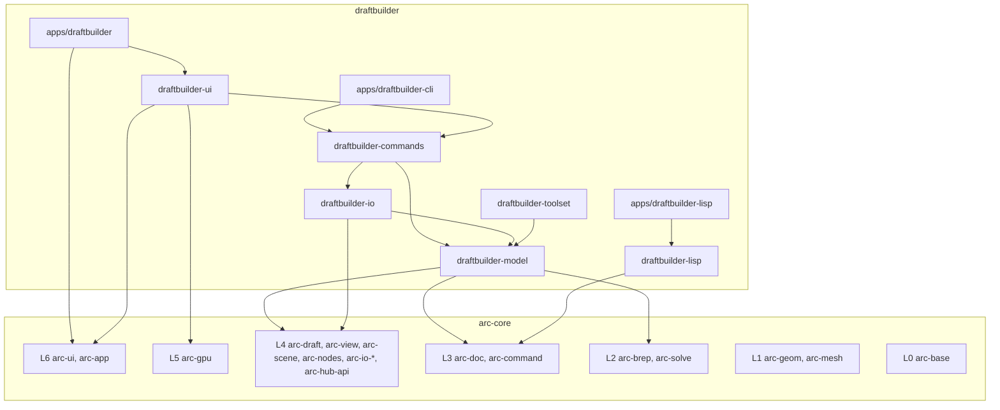
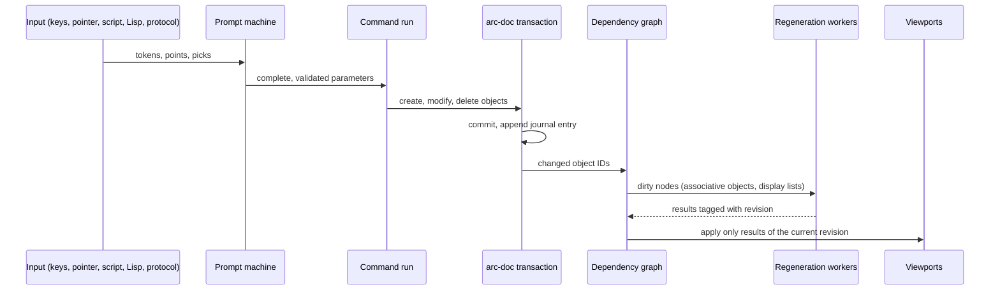

# DraftBuilder architecture overview

This document describes the crates of this repository, how they use the `arc-core` foundation, the
main runtime flows, the product-specific subsystems, threading, performance targets, the automation
surface and the testing strategy. Suite-wide architecture is defined in
[`arc-suite`](https://github.com/ACKaraca/arc-suite) and its
[decision records](https://github.com/ACKaraca/arc-suite/tree/main/docs/adr) and is not repeated here.

## Crates

The repository follows the suite product template. Two crates are added because each has a real
second boundary: the Lisp-dialect interpreter runs in its own process, and toolsets are separately
enabled modules that share one framework.

| Crate | Kind | Responsibility |
|---|---|---|
| `crates/draftbuilder-model` | library, headless | The drawing database: DWG-aligned object types over `arc-draft`, owner tree, handles and stable IDs, symbol tables, dictionaries, extended data, preserved foreign objects, associativity rules (dimensions, hatches, arrays, fields, dynamic blocks, constraints), regeneration nodes, settings and the setting-name compatibility table |
| `crates/draftbuilder-commands` | library, headless | Every user-level command: parameter schema, non-interactive `run`, interactive prompt machine, option keywords, aliases, transparent-command eligibility |
| `crates/draftbuilder-io` | library, headless | Mapping between the drawing database and the neutral models of `arc-io-dwg` and `arc-io-dxf`, and between drawings and other formats (PDF, SVG, raster, IFC, STEP, mesh formats, point clouds, KML); loss reports |
| `crates/draftbuilder-lisp` | library, headless | Reader, evaluator and standard library of the Lisp dialect used by existing drawing routines; drawing access through the automation protocol; dialog definitions (DCL) as a declarative description |
| `crates/draftbuilder-toolset` | library, headless | Toolset framework: typed domain objects with property sets, styles and display representations, schedules, catalogs, projects, degradation to plain entities (phase 4; see [20-toolset-framework.md](../product/capabilities/20-toolset-framework.md)) |
| `crates/draftbuilder-ui` | library | Tools, panels (layers, properties, references, blocks, sheet sets, compare), cursor input, grips, command line integration, DCL dialog rendering |
| `toolsets/<name>` | libraries, headless | One crate per toolset on `draftbuilder-toolset`; created when the toolset starts |
| `apps/draftbuilder` | binary | Desktop application: wiring only |
| `apps/draftbuilder-cli` | binary | Headless CLI: open, convert, validate, audit, plot, publish, compare, run scripts and Lisp files, serve the automation protocol |
| `apps/draftbuilder-lisp` | binary | Out-of-process host for the Lisp interpreter ([ADR-0005](../adr/0005-lisp-interpreter-out-of-process.md)) |

`draftbuilder-lisp` depends on the automation protocol types in `arc-command` only; it never links
the model, which keeps the interpreter replaceable and the process boundary honest.

## Use of `arc-core`

| Crate | Used for |
|---|---|
| `arc-base` | Stable identifiers, units, tolerances, colors (index, true color, color books), errors |
| `arc-geom` | Lines, arcs, ellipses, splines, polylines with bulges, regions and 2D booleans, offsets, intersections for trim, extend, fillet and object snaps, spatial indexes for selection and snapping, hatch boundary detection |
| `arc-mesh` | Polyface and subdivision meshes, mesh editing and smoothing |
| `arc-brep` | Solids and surfaces, booleans, fillets, shells, sections, mass properties, STEP exchange (phase 3) |
| `arc-solve` | 2D geometric and dimensional constraints, the parameter table and expression engine, dynamic-block parameter evaluation |
| `arc-doc` | Object store, transactions, operation journal, undo and redo, dependency graph and regeneration scheduler, external reference resolution, the `.draftb` sidecar package |
| `arc-command` | Command registry, parameter schemas, prompt machines, command-line parsing, macro recording, automation protocol endpoint, headless runner |
| `arc-draft` | Shared drafting model: entities, layers, linetypes, text and fonts, dimensions, hatches, blocks, tables, layouts, plot styles, annotation scaling, the sheet and plot pipeline |
| `arc-view` | Flat projection, hidden-line views and drawing views of 3D content |
| `arc-scene` | Arc Scene export to RenderBuilder |
| `arc-nodes` | Node graphs over commands (phase 4) |
| `arc-io-dwg`, `arc-io-dxf` | Neutral models of the DWG and DXF formats, readers and writers ([dwg-compatibility.md](dwg-compatibility.md)) |
| `arc-io-pdf`, `arc-io-mesh`, `arc-io-step`, `arc-io-ifc`, `arc-io-pointcloud`, `arc-io-geo` | Other formats ([interoperability.md](interoperability.md)) |
| `arc-hub-api` | Opening and saving through Arc Hub, locks, versions, reviews, issues, change sets |
| `arc-gpu` | 2D and 3D viewport, drafting-quality lines, lineweights, hatches, text, picking, point clouds |
| `arc-ui`, `arc-app` | Docking workspace, command line, property grid, trees, palettes, settings, localization, plug-in loading, assistant panel |

## Runtime flows

### Command to view

1. Input arrives as tokens. The prompt machine of the active command interprets them against its
   current prompt (point, distance, keyword, selection) and produces typed parameters. Scripts, Lisp
   routines and the protocol either drive the same prompt machine token by token or call `run` with
   complete parameters.
2. `run` validates parameters and changes the database inside one transaction. A failure rolls the
   transaction back; nothing reaches the journal.
3. The commit records element-level operations with before and after states in the operation
   journal, which drives undo, redo, history, compare and change sets.
4. The dependency graph marks dependents dirty: associative dimensions, hatches, arrays, fields,
   dynamic block representations, constraint systems, toolset objects and display lists.
5. Regeneration runs on worker threads; each result carries the revision it was computed from and is
   discarded if the document moved on. Viewports draw from display lists, never from the database.

### Open and save

Opening reads the file through `arc-io-dwg` or `arc-io-dxf` into a neutral model, maps it into the
drawing database in parallel per block record, keeps unmapped content in the preservation store and
builds a preservation report. Saving maps the database back to the neutral model, merges preserved
content, writes to a temporary file and replaces the target atomically. The sidecar package is
written in the same save. Details are in [dwg-compatibility.md](dwg-compatibility.md).

### Plot and publish

A layout is turned into a sheet description by the shared `arc-draft` sheet pipeline (viewports
clipped and scaled, plot styles resolved, lineweights in paper units) and written by `arc-io-pdf`,
the SVG writer or the raster backend. Plotting runs on a snapshot of the document revision, so editing
continues during background plots.

## Product-specific subsystems

| Subsystem | Crate | Notes |
|---|---|---|
| Drawing database layer | model | Owner tree, handle seed and allocation, symbol tables, dictionaries, reserved records; see [domain-model.md](domain-model.md) |
| Preservation store | model, io | Keeps unknown classes, objects, extended data and unmapped fields with their owner links ([ADR-0003](../adr/0003-lossless-preservation.md)) |
| Associativity engine | model | Regeneration nodes for associative dimensions, hatches, arrays, fields, leaders, center marks, dynamic blocks and constraints |
| Display list builder | model, `arc-gpu` | Curve tessellation, linetype generation, hatch line generation, text shaping including shape fonts, proxy graphics; parallel per block record and tile |
| Command line and prompt machines | commands, ui | See [command-line.md](command-line.md) |
| Settings and compatibility names | model | Typed DraftBuilder settings with scopes (drawing, profile, session) and a table of widely used setting names accepted from scripts, routines and drawings |
| Reference manager | model, io | Path resolution, nested references, cycle detection, demand loading, reload on change |
| Lisp host | lisp | Out-of-process interpreter speaking the automation protocol |
| Toolset framework | toolset | Typed objects stored as custom objects with proxy graphics and plain-entity fallbacks ([ADR-0006](../adr/0006-toolset-objects-degrade-to-entities.md)) |

## Threading and background work

- The UI thread handles input, layout and drawing of the interface; it never waits on the database.
- Each open drawing has one writer: commands run on that document's command thread. Readers
  (regeneration, plotting, saving, compare) work on immutable snapshots, which structural sharing in
  `arc-doc` makes cheap.
- Regeneration, file mapping, hatch generation, text shaping and selection queries over large sets
  run on a shared worker pool, partitioned by block record and spatial tile.
- Background jobs (plotting, publishing, point cloud indexing, reference reloads, audits, saves) are
  cancellable, report progress and apply results only to the revision they started from.
- The Lisp interpreter runs in its own process; a runaway routine is stopped without affecting the
  drawing, and its partial transaction is rolled back.

## Performance targets

Targets are acceptance budgets on a reference workstation defined in the suite engineering standards;
they are design goals, not measurements.

| Target | Budget | Rationale |
|---|---|---|
| Open a 100 MB drawing with 2 million entities | Interactive within 10 s; full regeneration continues in the background | Large survey and site drawings of this size are routine |
| Pan and zoom | 60 frames per second with 5 million visible segments | Navigation must never stall drafting |
| Typical modify command on up to 10,000 objects | Committed and displayed within 100 ms | Keeps keyboard work fluid |
| Regeneration after a single edit | Dependents updated within 50 ms | Associative objects must appear to follow the cursor |
| Object snap and selection preview | Under 8 ms per pointer move | Snapping must keep up with the pointer |
| Save | Not slower than open for the same drawing | Frequent saving must stay cheap |
| Lisp entity access | 20,000 entity reads or writes per second through batched protocol calls | Existing batch routines must stay practical out of process |

## Automation surface

Every capability is reachable through the command registry. The registry is exposed through menus
and panels, the command line, macro recording, scripts, the Lisp interpreter, the Arc Automation
Protocol, the Model Context Protocol endpoint, the Python client, the headless CLI, node graphs
(phase 4) and WebAssembly plug-ins (phase 3). The same commands run as Arc Hub jobs through the CLI.
See [command-line.md](command-line.md) and
[18-customization-automation.md](../product/capabilities/18-customization-automation.md).

## Testing strategy

- **Round-trip corpus.** DWG and DXF files from the suite corpus repositories, each with owner,
  license and checksum, are opened and saved; object counts, handles, preserved content and geometry
  are compared, and an independent reader checks every written file
  ([dwg-compatibility.md](dwg-compatibility.md)).
- **Fuzzing.** The DWG and DXF readers, the Lisp reader, the alias, linetype, pattern, plot style
  and shape-font parsers are fuzzed continuously; every crash fix adds a regression input.
- **Command scripts.** Behavior is specified as script tests: a starting drawing, a sequence of
  command-line tokens, and expected database state, so interactive and non-interactive paths are
  tested by the same files.
- **Plot comparison.** Plotted sheets are rasterized and compared with reference images at fixed
  resolution, on all three platforms.
- **Lisp conformance.** A suite of routines covers each supported function with expected results.
- **Performance budgets.** The targets above run as benchmarks in CI and fail the build when exceeded
  by the configured margin.
- **Accessibility and localization.** Tests check accessible names, keyboard reachability and that
  every user-visible string comes from a message catalog.
