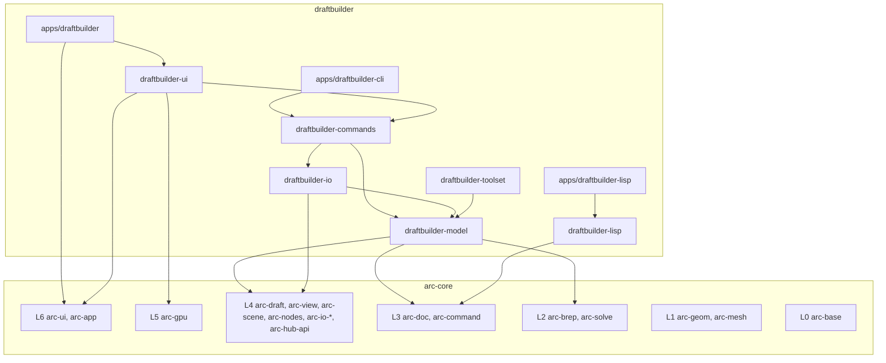
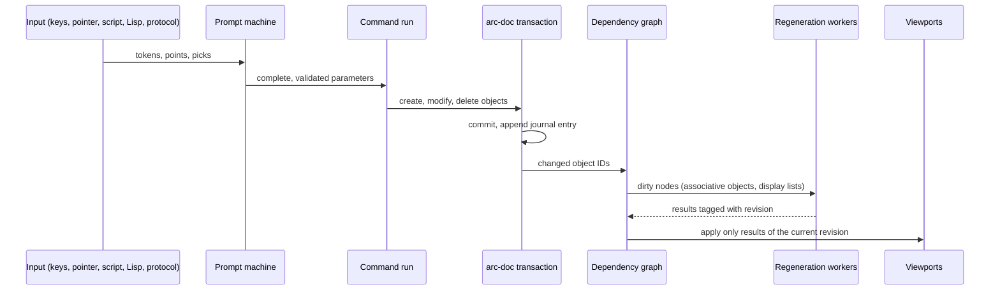

# DraftBuilder architecture overview

This document describes the crates of this repository, how they use the `arc-core` foundation, the
main runtime flows, the product-specific subsystems, threading, performance targets, the automation
surface and the testing strategy. Suite-wide architecture is defined in
[`arc-suite`](https://github.com/ACKaraca/arc-suite) and its
[decision records](https://github.com/ACKaraca/arc-suite/tree/main/docs/adr) and is not repeated here.

## Crates

The repository follows the suite product template. Two crates are added because each has a real
second boundary: the Lisp-dialect interpreter runs in its own process, and toolsets are separately
enabled modules that share one framework.

| Crate | Kind | Responsibility |
|---|---|---|
| `crates/draftbuilder-model` | library, headless | The drawing database: DWG-aligned object types over `arc-draft`, owner tree, handles and stable IDs, symbol tables, dictionaries, extended data, preserved foreign objects, associativity rules (dimensions, hatches, arrays, fields, dynamic blocks, constraints), regeneration nodes, settings and the setting-name compatibility table |
| `crates/draftbuilder-commands` | library, headless | Every user-level command: parameter schema, non-interactive `run`, interactive prompt machine, option keywords, aliases, transparent-command eligibility |
| `crates/draftbuilder-io` | library, headless | Mapping between the drawing database and the neutral models of `arc-io-dwg` and `arc-io-dxf`, and between drawings and other formats (PDF, SVG, raster, IFC, STEP, mesh formats, point clouds, KML); loss reports |
| `crates/draftbuilder-lisp` | library, headless | Reader, evaluator and standard library of the Lisp dialect used by existing drawing routines; drawing access through the automation protocol; dialog definitions (DCL) as a declarative description |
| `crates/draftbuilder-toolset` | library, headless | Toolset framework: typed domain objects with property sets, styles and display representations, schedules, catalogs, projects, degradation to plain entities (phase 4; see [20-toolset-framework.md](../product/capabilities/20-toolset-framework.md)) |
| `crates/draftbuilder-ui` | library | Tools, panels (layers, properties, references, blocks, sheet sets, compare), cursor input, grips, command line integration, DCL dialog rendering |
| `toolsets/<name>` | libraries, headless | One crate per toolset on `draftbuilder-toolset`; created when the toolset starts |
| `apps/draftbuilder` | binary | Desktop application: wiring only |
| `apps/draftbuilder-cli` | binary | Headless CLI: open, convert, validate, audit, plot, publish, compare, run scripts and Lisp files, serve the automation protocol |
| `apps/draftbuilder-lisp` | binary | Out-of-process host for the Lisp interpreter ([ADR-0005](../adr/0005-lisp-interpreter-out-of-process.md)) |
| `apps/draftbuilder-web`, `apps/draftbuilder-mobile` | binaries | Browser (WebAssembly) and tablet and phone entry points: wiring only, on the same crates ([ADR-0007](../adr/0007-web-and-mobile-targets.md)) |
| `apps/draftbuilder-com` | binary, Windows only | Out-of-process automation bridge, a protocol client ([ADR-0008](../adr/0008-windows-integration-crate.md)) |
| `crates/draftbuilder-windows` | library, Windows only | The FFI crate for object linking and the automation server ([ADR-0008](../adr/0008-windows-integration-crate.md)) |

`draftbuilder-lisp` depends on the automation protocol types in `arc-command` only; it never links
the model, which keeps the interpreter replaceable and the process boundary honest.

## Use of `arc-core`

| Crate | Used for |
|---|---|
| `arc-base` | Stable identifiers, units, tolerances, colors (index, true color, color books), errors |
| `arc-geom` | Lines, arcs, ellipses, splines, polylines with bulges, regions and 2D booleans, offsets, intersections for trim, extend, fillet and object snaps, spatial indexes for selection and snapping, hatch boundary detection |
| `arc-mesh` | Polyface and subdivision meshes, mesh editing and smoothing |
| `arc-brep` | Solids and surfaces, booleans, fillets, shells, sections, mass properties, STEP exchange (phase 3) |
| `arc-solve` | 2D geometric and dimensional constraints, the parameter table and expression engine, dynamic-block parameter evaluation |
| `arc-doc` | Object store, transactions, operation journal, undo and redo, dependency graph and regeneration scheduler, external reference resolution, the `.draftb` sidecar package |
| `arc-command` | Command registry, parameter schemas, prompt machines, command-line parsing, macro recording, automation protocol endpoint, headless runner |
| `arc-draft` | Shared drafting model: entities, layers, linetypes, text and fonts, dimensions, hatches, blocks, tables, layouts, plot styles, annotation scaling, the sheet and plot pipeline |
| `arc-view` | Flat projection, hidden-line views and drawing views of 3D content |
| `arc-scene` | Arc Scene export to RenderBuilder |
| `arc-nodes` | Node graphs over commands (phase 4) |
| `arc-io-dwg`, `arc-io-dxf` | Neutral models of the DWG and DXF formats, readers and writers ([dwg-compatibility.md](dwg-compatibility.md)) |
| `arc-io-pdf`, `arc-io-mesh`, `arc-io-step`, `arc-io-ifc`, `arc-io-pointcloud`, `arc-io-geo` | Other formats ([interoperability.md](interoperability.md)) |
| `arc-io-dgn`, `arc-io-3dm` | Open readers for DGN V7 and Rhino 3DM (phase 5) |
| `arc-hub-api` | Opening and saving through Arc Hub, locks, versions, reviews, issues, change sets |
| `arc-gpu` | 2D and 3D viewport, drafting-quality lines, lineweights, hatches, text, picking, point clouds |
| `arc-ui`, `arc-app` | Docking workspace, command line, property grid, trees, palettes, settings, localization, plug-in loading, assistant panel |

## Runtime flows

### Command to view

1. Input arrives as tokens. The prompt machine of the active command interprets them against its
   current prompt (point, distance, keyword, selection) and produces typed parameters. Scripts, Lisp
   routines and the protocol either drive the same prompt machine token by token or call `run` with
   complete parameters.
2. `run` validates parameters and changes the database inside one transaction. A failure rolls the
   transaction back; nothing reaches the journal.
3. The commit records element-level operations with before and after states in the operation
   journal, which drives undo, redo, history, compare and change sets.
4. The dependency graph marks dependents dirty: associative dimensions, hatches, arrays, fields,
   dynamic block representations, constraint systems, toolset objects and display lists.
5. Regeneration runs on worker threads; each result carries the revision it was computed from and is
   discarded if the document moved on. Viewports draw from display lists, never from the database.

### Open and save

Opening reads the file through `arc-io-dwg` or `arc-io-dxf` into a neutral model, maps it into the
drawing database in parallel per block record, keeps unmapped content in the preservation store and
builds a preservation report. Saving maps the database back to the neutral model, merges preserved
content, writes to a temporary file and replaces the target atomically. The sidecar package is
written in the same save. Details are in [dwg-compatibility.md](dwg-compatibility.md).

### Plot and publish

A layout is turned into a sheet description by the shared `arc-draft` sheet pipeline (viewports
clipped and scaled, plot styles resolved, lineweights in paper units) and written by `arc-io-pdf`,
the SVG writer or the raster backend. Plotting runs on a snapshot of the document revision, so editing
continues during background plots.

## Product-specific subsystems

| Subsystem | Crate | Notes |
|---|---|---|
| Drawing database layer | model | Owner tree, handle seed and allocation, symbol tables, dictionaries, reserved records; see [domain-model.md](domain-model.md) |
| Preservation store | model, io | Keeps unknown classes, objects, extended data and unmapped fields with their owner links ([ADR-0003](../adr/0003-lossless-preservation.md)) |
| Associativity engine | model | Regeneration nodes for associative dimensions, hatches, arrays, fields, leaders, center marks, dynamic blocks and constraints |
| Display list builder | model, `arc-gpu` | Curve tessellation, linetype generation, hatch line generation, text shaping including shape fonts, proxy graphics; parallel per block record and tile |
| Command line and prompt machines | commands, ui | See [command-line.md](command-line.md) |
| Settings and compatibility names | model | Typed DraftBuilder settings with scopes (drawing, profile, session) and a table of widely used setting names accepted from scripts, routines and drawings |
| Reference manager | model, io | Path resolution, nested references, cycle detection, demand loading, reload on change |
| Lisp host | lisp | Out-of-process interpreter speaking the automation protocol |
| Toolset framework | toolset | Typed objects stored as custom objects with proxy graphics and plain-entity fallbacks ([ADR-0006](../adr/0006-toolset-objects-degrade-to-entities.md)) |

## Web and mobile targets

The browser, tablet and phone builds compile `draftbuilder-model`, `-commands`, `-io` and
`-toolset` and the same `draftbuilder-ui` for `wasm32`, iOS and Android
([ADR-0007](../adr/0007-web-and-mobile-targets.md)). Platform facilities (files, storage, camera,
location) come through `arc-app`. Each registered command carries a target-availability flag, so
staging from viewing to full 2D editing is a release decision. An offline replica holds the drawing,
its journal and pending change sets; synchronization and shared sessions use `arc-hub-api`.
Components that cannot run on a device, such as the Lisp host, run as Arc Hub jobs.

## Threading and background work

- The UI thread handles input, layout and drawing of the interface; it never waits on the database.
- Each open drawing has one writer: commands run on that document's command thread. Readers
  (regeneration, plotting, saving, compare) work on immutable snapshots, which structural sharing in
  `arc-doc` makes cheap.
- Regeneration, file mapping, hatch generation, text shaping and selection queries over large sets
  run on a shared worker pool, partitioned by block record and spatial tile.
- Background jobs (plotting, publishing, point cloud indexing, reference reloads, audits, saves) are
  cancellable, report progress and apply results only to the revision they started from.
- The Lisp interpreter runs in its own process; a runaway routine is stopped without affecting the
  drawing, and its partial transaction is rolled back.

## Performance targets

Targets are acceptance budgets on a reference workstation defined in the suite engineering standards;
they are design goals, not measurements.

| Target | Budget | Rationale |
|---|---|---|
| Open a 100 MB drawing with 2 million entities | Interactive within 10 s; full regeneration continues in the background | Large survey and site drawings of this size are routine |
| Pan and zoom | 60 frames per second with 5 million visible segments | Navigation must never stall drafting |
| Typical modify command on up to 10,000 objects | Committed and displayed within 100 ms | Keeps keyboard work fluid |
| Regeneration after a single edit | Dependents updated within 50 ms | Associative objects must appear to follow the cursor |
| Object snap and selection preview | Under 8 ms per pointer move | Snapping must keep up with the pointer |
| Save | Not slower than open for the same drawing | Frequent saving must stay cheap |
| Lisp entity access | 20,000 entity reads or writes per second through batched protocol calls | Existing batch routines must stay practical out of process |

## Automation surface

Every capability is reachable through the command registry. The registry is exposed through menus
and panels, the command line, macro recording, scripts, the Lisp interpreter, the Arc Automation
Protocol, the Model Context Protocol endpoint, the Python client, the headless CLI, node graphs
(phase 4) WebAssembly plug-ins (phase 3) and, on Windows, the automation bridge (phase 5). The same commands
run as Arc Hub jobs through the CLI.
See [command-line.md](command-line.md) and
[18-customization-automation.md](../product/capabilities/18-customization-automation.md).

## Implemented in M0

Milestone M0 ([roadmap](../roadmap.md)) built the part of the structure above that proves the
mapping onto `arc-doc` and `arc-draft`. Everything not listed here is still design.

| Part | State |
|---|---|
| Crates | `draftbuilder-model`, `-io`, `-commands`, `apps/draftbuilder` (over the `arc-app` shell, without a `draftbuilder-ui` crate: the viewport, outliner, property grid and command line panels of `arc-app` are enough), `apps/draftbuilder-cli`, `xtask`. The foundation is one pinned revision of `arc-core`. |
| Document type set | The drafting types of `arc-draft`. The drawing database adds no object types. |
| Handles | The bindings are the source map of `arc-doc` that `arc-draft-dxf` writes on import (format `dxf`, document label `drawing`) and reads on export. `draftbuilder-model` is a view over it. |
| High-water mark, fingerprint | `draftbuilder-model` keeps these two as `arc-doc` foreign data rows: the highest handle the drawing has had (the `floor` of the export) and the fingerprint with its origin (file or assigned). Rows are journaled, undone with the commands that wrote them and saved in the package. Rows of deleted objects stay, so a handle is not issued again. |
| Stable IDs | `stable_id` computes the version 5 UUID over the fingerprint and the handle (ADR-0002). Nothing is stored for it, and the journal still addresses objects by their `arc-doc` identifier. |
| Open | `draftbuilder.drawing.open_dxf` reads the file with `arc-io-dxf`, plans the import with `arc-draft-dxf` (source document label `drawing`) and applies it in one undoable transaction; the import binds every object it creates from a file object to its handle. |
| Save | `draftbuilder.drawing.save_dxf` exports the model space with `HandlePolicy::KeepSources` and the high-water mark as floor, keeps the fingerprint (or assigns one and says so in the report), writes a new version GUID on every save and a new fingerprint for an independent copy. Objects the file did not have get handles above the floor; the command records them as bindings in its transaction and raises the mark. |
| Reports | The loss and preservation report of `arc-io-dxf` and `arc-draft-dxf` (which names repeated and reassigned handles) is returned by both commands, with the product item `db.io.fingerprint_assigned`. |
| Move | The alias `move` of `core.draft.entity.transform`. The command-line prompts for it are not built. |
| CLI | The shared subcommands of the Arc suite with the product's drafting validators installed on every document and `view.render` answered by the drafting renderer, and `render` (the model space to PNG through `arc_app::render`). A script opens, moves, undoes (`history.undo`) and saves over `serve --stdio --create`. |
| Application | The viewport draws the model space through the drafting extractor of `arc-gpu`. DXF is a native format of the application: a `.dxf` opens and saves through its own open and save path with `open_document` and `save_document`. Shell messages come from the shared catalogs of `arc-app`. |
| Working file | The CLI works on a document package with the extension `draftb`, which holds the drawing database of an opened DXF drawing so that several processes can work on it. The sidecar of [ADR-0001](../adr/0001-drawing-database-is-the-model.md), which accompanies the native `.dxf` file, is not built yet; a `.dxf` opened in the application has no package, no edit lock and no recovery journal. |

Handles that a saved file keeps are those of the layers, linetypes, text styles, block records
(the `BLOCK_RECORD` entries) and the entities of the model space and of blocks that were in the
opened file. Handles it does not keep:

- the `BLOCK` and `ENDBLK` records of blocks, the `TABLE` headers and the `VERTEX` and `SEQEND`
  records of classic polylines, which are not objects of the drafting model (a classic polyline is
  written as a lightweight polyline with the handle of its `POLYLINE` record);
- the viewport, application-name and dimension-style tables, the paper space and model space block
  records, the layouts and the dictionaries, which the export writes itself (the root dictionary
  keeps 0xC unless an object holds it);
- the standard linetypes (`Continuous`, `ByLayer`, `ByBlock`), which the export writes itself when
  the document has no linetype of that name;
- the attribute definitions and attribute values of blocks, paper space entities and objects of
  types `arc-draft` has no object for, except records kept as foreign data, which keep theirs;
- objects of a file that repeats a handle, after the first occurrence.

Known limits of the prototype: undo history does not survive a restart, so `history.undo` works
inside one `serve` session; a save that records handles is a step in the history, and undoing it
forgets the records (the process-wide mark keeps the written handles from being issued to another
object while the process lives, but a later process that opens the package continues from the
lower mark in the document); and one drawing per document: opening a second file into a document
is refused.

### Commands and formats added after M0

| Part | State |
|---|---|
| Vocabulary and name forms | `draftbuilder-commands` holds the typed names and aliases (`OPEN`, `NEW`, `SAVE`, `AUDIT`, `PURGE`, `MOVE` with `M`) in one table, applied to the registry through arc-command's user aliases. The prefixes `_` (English name), `-` (prompt form) and `.` (built-in command) are read by the product, and the CLI `run` subcommand accepts them. The protocol takes identifiers, typed names and aliases; see [command-line.md](command-line.md#aliases-and-command-resolution). Completion ignores surrounding whitespace, as parsing does, and the built-in form offers only the names it resolves. |
| Open | `draftbuilder.drawing.open` reads a DWG file through `arc-io-dwg` (R13 to R2018, experimental for files that are not trusted) or a DXF file. The content decides the format: a DWG version signature, or the section markers of a DXF; the file name decides only when the content names neither. `draftbuilder.drawing.open_dxf` reads DXF only. The reader's report is merged into the plan's report. |
| Units | An optional `unit` is the drawing's unit. The content is scaled by the factor the DXF mapper applies, and the report carries the mapper's own item: `draft.dxf.units_converted` with the source code and the factor, or `draft.dxf.units_unitless` when nothing is converted. Model-space geometry and text heights are scaled. Block content keeps the unit of its block record; the drafting model converts a reference when it draws. |
| New | `draftbuilder.drawing.new` creates an empty drawing from the metric or imperial default, or from a template drawing (DWG or DXF). A template contributes its layers, linetypes, text styles, dimension styles and unit. Its geometry, blocks, objects, layouts and page setups are not copied, and its handles are not kept. A new drawing has no report. |
| Save | `draftbuilder.drawing.save` and `draftbuilder.drawing.save_dxf` write DXF for versions 2000 to 2018. The target must be a regular file or absent, and it is checked against the write roots first. The file is written to a temporary file created exclusively beside the target under a name with a random part; the temporary file takes the target's permissions, is synced, and replaces the target by a rename, after which the directory is synced on Unix. A failed save removes the temporary file and leaves the target as it was. A DWG target is refused, because DWG writing is not available. |
| Audit | `draftbuilder.drawing.audit` reports owner, handle-binding and curve geometry findings. It lists at most the session's record limit and counts the rest. It repairs nothing. |
| Purge | `draftbuilder.drawing.purge` removes unused layers, linetypes, block definitions and styles. With `repeat` it makes passes until nothing more is unused, up to 64 passes; a preview runs the same passes and rolls them back, so it lists what a run removes. Protected names are kept per category: layers `0` and `Defpoints`, linetypes `Continuous`, `ByLayer` and `ByBlock`, and the text style `Standard`. A name that a preserved record of the file contains is kept too. |
| Reports | Open and save return the loss report, which the CLI and the protocol return as JSON ([interoperability.md](interoperability.md#report-format)). |
| Selection | `draftbuilder.select.window`, `crossing`, `window_polygon`, `crossing_polygon`, `fence`, `all`, `last`, `previous`, `filter` (typed `FILTER`) and `similar` return the objects of a space (the model space by default, or any space or block definition named by `space`). Each is a pure function over the snapshot in `select::methods` and `select::query`, with its candidates from `select::candidates`. An entity is tested by its display-list curves with the exact tests of `arc-geom`: inside means every stretch of the curve between its crossings with the boundary lies inside, touching counts, and crossing means any part inside or meeting the boundary. A stroke gives its whole curve, a fill, mask or region its boundary, a block reference all of its flattened primitives, a dimension its strokes and a hatch its boundary and pattern. Text in a stroke font is tested by its curves; text in an outline font by the box of its glyph positions. Objects that are invisible or on an off or frozen layer are never picked, and objects on a locked layer only with `include_locked`. The commands are read-only: they change no document state, create no undo step and leave the session selection alone. The caller passes the current set for `mode` (`replace`, `add`, `remove`) and `within_current`, and the previous set to `previous`; previous across commands is not available until the foundation keeps session selection state. `last` is the topmost object (draw order). The cycling order of overlapping candidates is a pure function (`select::cycle`). |
| Layers and properties | `draftbuilder.layer.create` (typed `LAYER`) creates a layer; `draftbuilder.layer.rename` renames one. Names are unique without regard to case (compared with `str::to_lowercase` on both sides) and checked with the drawing format's reserved characters, on create and rename. Layer `0` and the definition-point layer `Defpoints` cannot be renamed, deleted or merged away. `draftbuilder.layer.delete` removes unused layers through the foundation's delete (typed names none); `draftbuilder.layer.delete_with_contents` (`LAYDEL`) removes layers with every object on them, including objects inside block definitions; `draftbuilder.layer.merge` (`LAYMRG`) moves the objects of source layers, including block content, to a target and removes the sources. `draftbuilder.layer.modify` sets the flags, color, linetype, lineweight, transparency and description of layers; `draftbuilder.layer.on`, `off`, `freeze`, `thaw`, `lock` and `unlock` (typed `LAYON`, `LAYOFF`, `LAYFRZ`, `LAYTHW`, `LAYLCK`, `LAYULK`) act on the layers of chosen objects; `draftbuilder.layer.change` and `match` (`LAYMCH`) move objects to a named layer or to the layer of a source. `draftbuilder.property.change` (typed `CHPROP`, `CHANGE`) and `draftbuilder.property.match` (`MATCHPROP`) set and copy the layer and appearance of objects, with their sources (ByObject, ByLayer or ByBlock). The foundation refuses edits to objects on a locked layer in its own commands; the property and layer commands that write entities directly apply the same one-line rule, because the foundation's check is not public. Colors are index colors with their source kept; transparency of a layer is limited to 90 percent. `LINETYPE` is the typed name of `core.draft.linetype.load`. A new drawing holds layer `0`; opening a file without one creates it and the report carries `db.io.layer_zero_created`. Each command writes its fields in one transaction, so it is one undo step. |

Not implemented yet in selection and layers: picking, grips, highlight and the selection prompt machine (the prompt keywords `previous`, `last` and the mode switches); implicit windowing; groups; selection isolation and hiding; selection by name of a saved filter; properties by size; the previous set across commands and the noun-verb use of a selection, which need session selection state in the foundation; layer states; layer isolation; the current layer; layer walk; viewport layer overrides; the panels. The foundation (pinned `arc-core`) lacks: no session selection keyword in object parameters or prompts (`arc-command`: `IdParam`, the selection accept of `prompt.rs`); no selection record for a transaction without operations (`arc-command` protocol `run.rs` and `arc-doc` `commit.rs`); `arc-command` caps a session selection at 10,000 identifiers (`protocol/events.rs`, `MAX_SELECTED`); the commit name check compares bytes, not case (`arc-draft` `validate.rs`; the product checks case-insensitively on create and rename); no creation order for `last` (the `arc-doc` handle orders storage slots, `store.rs`); outline text exposes glyph positions only (`arc-draft` `display.rs`, `Shape::Glyphs`); the layer lock check is not public (`arc-draft` `lock.rs`), so the product repeats its rule for the entities it writes directly.

Not implemented yet: a read-only open and an initial view; DWG writing and save as DWG; DXF writing
for R12 to R14; the DWG fingerprint and handle seed, which `arc-io-dwg` does not carry (a DWG drawing
gets an assigned fingerprint, and its handle mark is the highest bound handle, not the file's seed);
the directory sync on Windows; an exclusive create on the command context (the save uses the roots'
reservation and reopens the placeholder); the independent-reader check in continuous integration; the
status-bar indicator; a human-readable report beside the JSON; placement of imports by insertion point
or geographic location; audit repairs; purge of empty text and of application names; layouts and page
setups of templates; scaling of linetype pattern lengths on unit conversion (the DXF mapping does not
scale them yet, see arc-core).

## Testing strategy

- **Round-trip corpus.** DWG and DXF files from the suite corpus repositories, each with owner,
  license and checksum, are opened and saved; object counts, handles, preserved content and geometry
  are compared, and an independent reader checks every written file
  ([dwg-compatibility.md](dwg-compatibility.md)).
- **Fuzzing.** The DWG and DXF readers, the Lisp reader, the alias, linetype, pattern, plot style
  and shape-font parsers are fuzzed continuously; every crash fix adds a regression input.
- **Command scripts.** Behavior is specified as script tests: a starting drawing, a sequence of
  command-line tokens, and expected database state, so interactive and non-interactive paths are
  tested by the same files.
- **Plot comparison.** Plotted sheets are rasterized and compared with reference images at fixed
  resolution, on all three platforms.
- **Lisp conformance.** A suite of routines covers each supported function with expected results.
- **Performance budgets.** The targets above run as benchmarks in CI and fail the build when exceeded
  by the configured margin.
- **Accessibility and localization.** Tests check accessible names, keyboard reachability and that
  every user-visible string comes from a message catalog.
